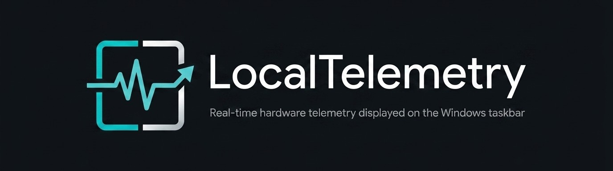
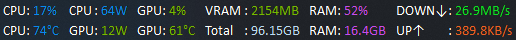
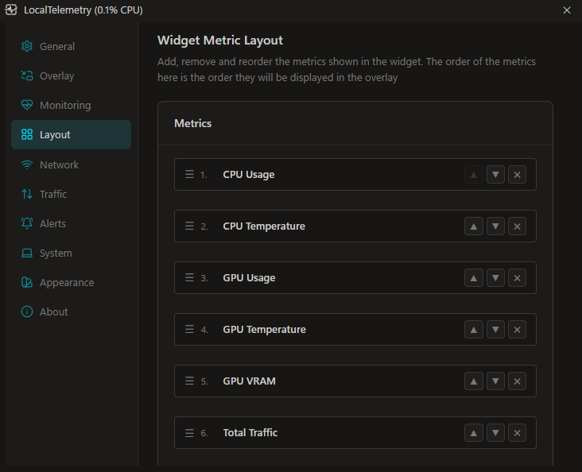
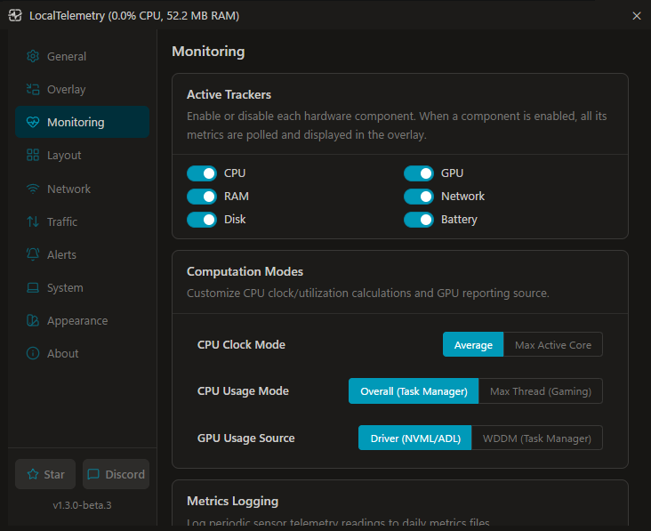
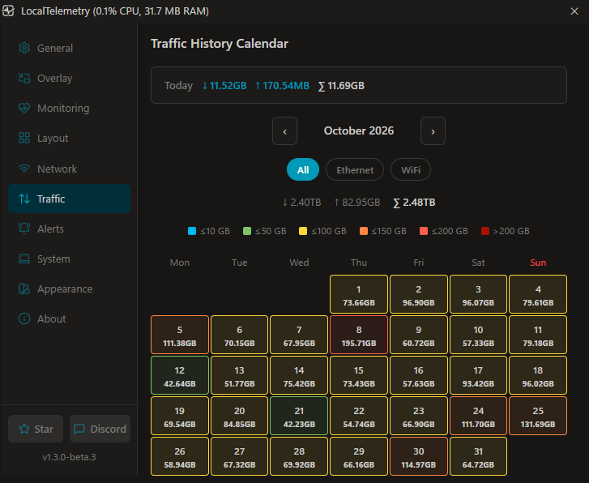
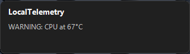

<p align="center">
    
</p>

<p align="center">
    <a href="https://github.com/Nicconike/LocalTelemetry/releases">
        
    </a>
    <a href="https://github.com/Nicconike/LocalTelemetry/releases">
        
    </a>
    <a href="https://github.com/Nicconike/LocalTelemetry">
        
    </a>
    <a href="https://github.com/Nicconike/LocalTelemetry/blob/main/LICENSE">
        
    </a>
    <a href="https://discord.gg/M2QevSgW3S">
        
    </a>
</p>

<p align="center">
    <details>
        <summary><strong>Continuous Integration, Code Quality & Security Audits</strong></summary>
        <br />
        <p align="center">
            <a href="https://github.com/Nicconike/LocalTelemetry/actions/workflows/ci.yml">
                
            </a>
            <a href="https://github.com/Nicconike/LocalTelemetry/actions/workflows/release.yml">
                
            </a>
            <a href="https://github.com/Nicconike/LocalTelemetry/actions/workflows/docs.yml">
                
            </a>
            <a href="https://sonarcloud.io/summary/new_code?id=LocalTelemetry">
                
            </a>
            <a href="https://codecov.io/gh/Nicconike/LocalTelemetry">
                
            </a>
        </p>
        <p align="center">
            <a href="https://dotnet.microsoft.com/">
                
            </a>
            <a href="https://svelte.dev/">
                
            </a>
            <a href="https://www.bestpractices.dev/projects/13911">
                
            </a>
            <a href="https://scorecard.dev/viewer/?uri=github.com/Nicconike/LocalTelemetry">
                
            </a>
            <a href="https://alternativeto.net/software/localtelemetry/about/?utm_source=badge&utm_medium=referral" target="_blank">
                
            </a>
            <a href="https://wakatime.com/badge/user/018e538b-3f55-4e8e-95fa-6c3225418eed/project/4a017698-b6e1-4859-a4f2-b5379b9a36ef">
                
            </a>
        </p>
    </details>
</p>

<p align="center">
    
</p>

<p align="center">
    <a href="https://nicconike.github.io/LocalTelemetry/"><strong>Documentation & Guides »</strong></a>
    ·
    <a href="https://nicconike.github.io/LocalTelemetry/user-guide/quickstart">Quickstart</a>
    ·
    <a href="https://nicconike.github.io/LocalTelemetry/user-guide/metrics-and-sensors">Supported Sensors</a>
    ·
    <a href="https://nicconike.github.io/LocalTelemetry/user-guide/customization">Customization</a>
    ·
    <a href="https://discord.gg/M2QevSgW3S">Discord</a>
</p>

---

## Quick Install

Download and run the installer directly from GitHub Releases:

1. Download **`LocalTelemetrySetup.exe`** from [**Latest GitHub Releases**](https://github.com/Nicconike/LocalTelemetry/releases/latest).
2. Run the installer and follow the setup wizard instructions. LocalTelemetry starts automatically.

You can also install via [**Scoop**](#option-2-scoop-package-manager):

```powershell
scoop bucket add localtelemetry https://github.com/Nicconike/LocalTelemetry
scoop install localtelemetry
```

---

## Why LocalTelemetry?

Vendor software suites (such as NZXT CAM, Corsair iCUE, and ASUS Armoury Crate) consume hundreds of megabytes of RAM just to show system temperatures. Windows 11 also removed support for legacy taskbar deskbands.

LocalTelemetry brings hardware monitoring back where it belongs: lightweight, native, and completely offline.

### Feature Comparison

| Feature | LocalTelemetry | Vendor Suites (iCUE / CAM) | Legacy Monitors |
| :--- | :---: | :---: | :---: |
| **Native Win 11 Taskbar Integration** | Embedded | Floating overlay only | Broken on Windows 11 |
| **Memory Footprint** | **~45–60 MB (Taskbar)** / ~180 MB with Settings (WebView2) | 400–900 MB (Electron) | ~20–30 MB |
| **Direct Register Sensors (MSR / SMN)** | PawnIO Kernel Driver | Proprietary / Slow | Basic WMI only |
| **Privacy & Offline Operation** | **100% Offline (Zero tracking)** | Cloud telemetry & analytics | Local |
| **Settings Technology** | **Svelte 5 UI** | Heavy Web Wrapper | Win32 / MFC |
| **Game-Safe Alerts** | Focus-safe background toasts | Minimizes full-screen games | None |

---

## Key Features

- **Native Taskbar Overlay**: Embeds live metrics next to your clock. Automatically supports both centered and left-aligned Windows 11 taskbars.
- **Overlay Layout Presets**: Switch instantly between curated presets (Default, Compact, Gaming, Full Telemetry) or create custom arrangements with drag-and-drop ordering, preset sorting, live preview, and variant controls.
- **Deep Kernel Telemetry**: Direct CPU clocks, wattage, and thermals via Intel MSR and AMD SMN registers with ACPI fallback. Full support for NVIDIA (NVML), AMD (ADL), and Intel (IGCL) GPUs.
- **Real-Time Network Speed & History**: Track live upload and download speeds with local daily history logging, JSONL backup imports, and Windows network usage backfilling.
- **Adaptive OEM Brand Themes**: Detects installed hardware vendors (Intel, AMD, NVIDIA, Samsung, Corsair) and applies authentic manufacturer color palettes.
- **100% Offline & Private**: Zero telemetry collection, zero trackers, and zero cloud calls. All metrics stay strictly on your local PC.
- **Smart Game-Safe Alerts**: Anti-spike sustained breach filtering, 10°C thermal hysteresis, taskbar warning highlights, and non-intrusive focus-safe desktop toasts.

---

## Visual Overview

### 1. Live Taskbar Overlay

Embeds directly into the Windows taskbar, matching system fonts and scaling automatically across multiple display DPIs:

<p align="center">
    
</p>

### 2. Svelte 5 Configuration Dashboard

Configure layout presets, polling intervals, and custom brand color schemes (Intel, AMD, NVIDIA, Corsair, Samsung) effortlessly:

<p align="center">
    
    
</p>

### 3. Traffic History Calendar

Inspect daily upload and download totals per network adapter with JSONL backup imports and historical Windows network usage backfilling:

<p align="center">
    
</p>

### 4. Non-Intrusive Threshold Alerts

Configure warning limits for CPU/GPU temperatures, clocks, or power. Toast alerts appear cleanly without interrupting gameplay, with anti-spike filtering and persistent overlay highlights:

<p align="center">
    
</p>

---

## Installation Options

### Option 1: Setup Wizard Installer (Recommended)

1. Download `LocalTelemetrySetup.exe` from [**GitHub Releases**](https://github.com/Nicconike/LocalTelemetry/releases).
2. Run the installer. Setup automatically verifies the .NET 10 Desktop Runtime and installs the required PawnIO kernel sensor driver.
3. LocalTelemetry starts immediately and runs quietly in your taskbar.

### Option 2: Scoop Package Manager

```powershell
scoop bucket add localtelemetry https://github.com/Nicconike/LocalTelemetry
scoop install localtelemetry
```

### Option 3: Portable ZIP

1. Ensure the required runtimes are installed:
   - [**Microsoft .NET 10 Desktop Runtime (x64)**](https://aka.ms/dotnet/10.0/windowsdesktop-runtime-win-x64.exe)
   - [**Microsoft Edge WebView2 Runtime (x64)**](https://go.microsoft.com/fwlink/p/?LinkId=2124703) *(pre-installed on Windows 11)*
2. Download `LocalTelemetry-win-x64.zip` from [**GitHub Releases**](https://github.com/Nicconike/LocalTelemetry/releases).
3. Extract and run `LocalTelemetry.exe` as Administrator.

<details>
<summary><strong>Verify Binary Signatures & SLSA Provenance</strong></summary>

<br />

Every release includes cryptographic hashes (`checksums.txt`), Sigstore Cosign signature bundles, and [SLSA](https://slsa.dev/) build attestations:

```powershell
# 1. Compare SHA-256 hashes against checksums.txt
Get-FileHash .\LocalTelemetrySetup.exe, .\LocalTelemetry-win-x64.zip -Algorithm SHA256

# 2. Verify keyless signatures with Cosign
cosign verify-blob --bundle .\LocalTelemetrySetup.exe.sigstore.json `
    --certificate-identity-regexp "https://github.com/Nicconike/LocalTelemetry/.*" `
    --certificate-oidc-issuer "https://token.actions.githubusercontent.com" `
    .\LocalTelemetrySetup.exe

# 3. Verify SLSA build provenance attestations
gh attestation verify .\LocalTelemetrySetup.exe --repo Nicconike/LocalTelemetry
gh attestation verify .\LocalTelemetry-win-x64.zip --repo Nicconike/LocalTelemetry
```

</details>

---

## System Requirements

| Requirement | Minimum Specification | Recommended Specification |
| :--- | :--- | :--- |
| **Operating System** | **Windows 10** (64-bit, v2004+ / build 19041) | **Windows 11** (64-bit, v22H2+) |
| **Architecture** | **x86-64 / AMD64** (Intel / AMD) | **x86-64 / AMD64** |
| **Permissions** | **Administrator** *(Required for PawnIO MSR kernel driver)* | **Administrator** |
| **Memory** | **2 GB RAM** | **4 GB RAM or higher** |
| **Runtimes** | **.NET 10 Desktop Runtime** & **WebView2** | **.NET 10 Desktop Runtime** & **WebView2** |

---

## Support & Community

If LocalTelemetry makes your desktop experience better, here is how you can support the project:

- **Star the Repository**: Star [**LocalTelemetry on GitHub**](https://github.com/Nicconike/LocalTelemetry) to help other users discover it.
- **Join the Discord Community**: Chat with the developer and get help on [**Discord**](https://discord.gg/M2QevSgW3S).
- **Suggest Features**: Share ideas or feature suggestions on [**GitHub Discussions**](https://github.com/Nicconike/LocalTelemetry/discussions).
- **Report Issues**: Found a bug or driver error? Open an issue on [**GitHub Issues**](https://github.com/Nicconike/LocalTelemetry/issues).
- **Upvote on AlternativeTo**: Recommend [**LocalTelemetry on AlternativeTo**](https://alternativeto.net/software/localtelemetry/about/?utm_source=badge&utm_medium=referral).

---

## License

This project is licensed under the terms described in the [LICENSE](LICENSE) file.
