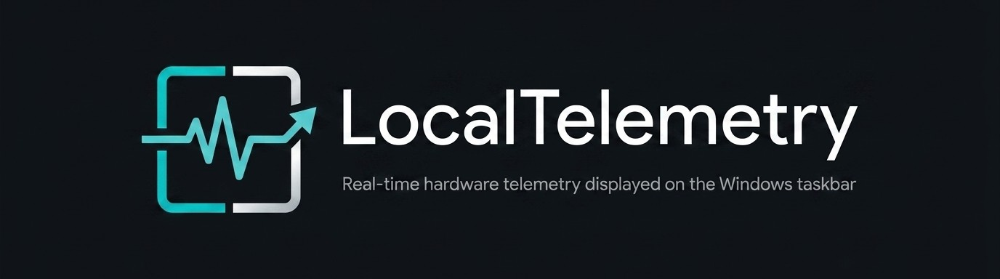
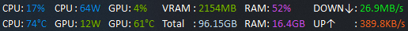
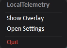
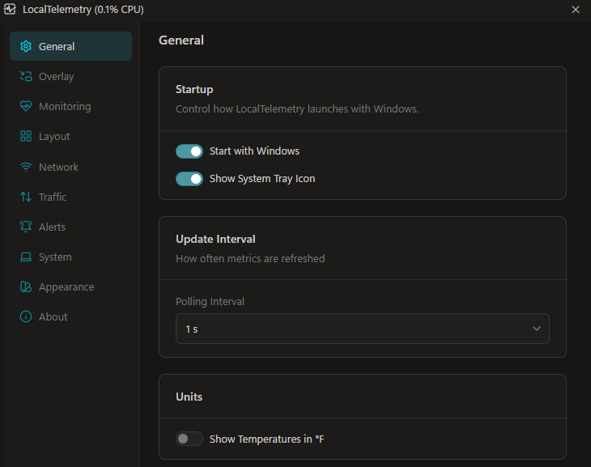
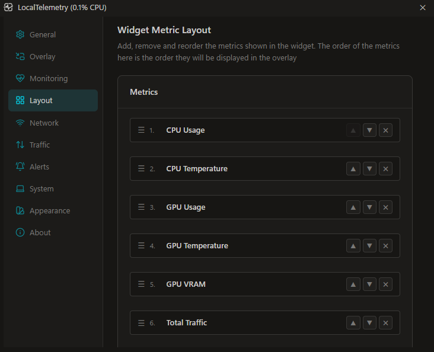
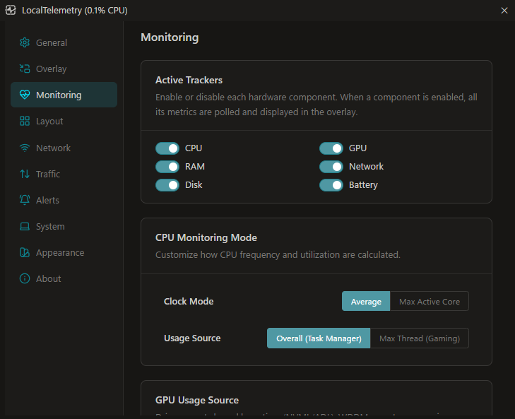
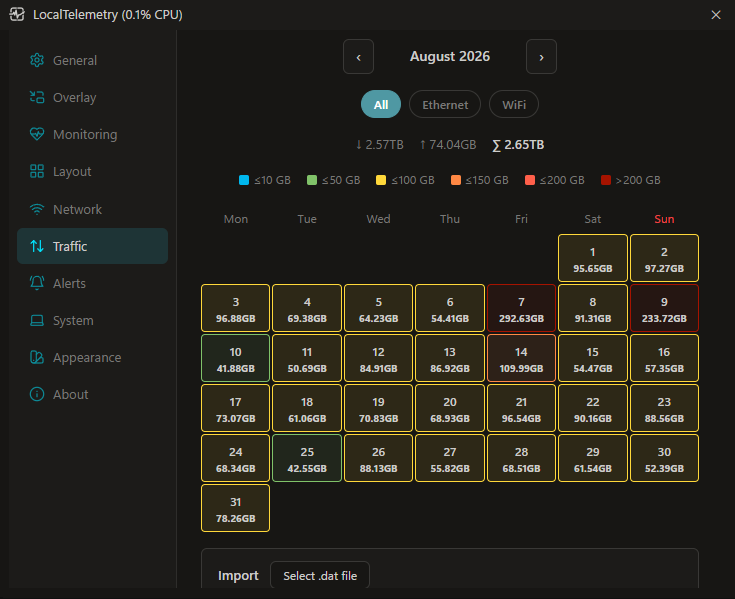
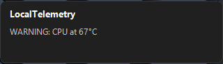

<p align="center">
    
</p>

<p align="center">
    <a href="https://github.com/Nicconike/LocalTelemetry/actions/workflows/ci.yml">
        
    </a>
    <a href="https://github.com/Nicconike/LocalTelemetry/actions/workflows/release.yml">
        
    </a>
    <a href="https://github.com/Nicconike/LocalTelemetry/actions/workflows/docs.yml">
        
    </a>
    <a href="https://sonarcloud.io/summary/new_code?id=LocalTelemetry">
        
    </a>
    <a href="https://codecov.io/gh/Nicconike/LocalTelemetry">
        
    </a>
</p>

<p align="center">
    <a href="https://github.com/Nicconike/LocalTelemetry/releases">
        
    </a>
    <a href="https://github.com/Nicconike/LocalTelemetry/releases">
        
    </a>
    <a href="https://nicconike.github.io/LocalTelemetry/">
        
    </a>
    <a href="https://discord.gg/M2QevSgW3S">
        
    </a>
    <a href="https://github.com/Nicconike/LocalTelemetry">
        
    </a>
</p>

<p align="center">
    <a href="https://github.com/Nicconike/LocalTelemetry">
        
    </a>
    <a href="https://dotnet.microsoft.com/">
        
    </a>
    <a href="https://svelte.dev/">
        
    </a>
    <a href="https://bun.sh/">
        
    </a>
</p>

<p align="center">
    <a href="https://www.bestpractices.dev/projects/13911">
        
    </a>
    <a href="https://scorecard.dev/viewer/?uri=github.com/Nicconike/LocalTelemetry">
        
    </a>
    <a href="https://wakatime.com/badge/user/018e538b-3f55-4e8e-95fa-6c3225418eed/project/4a017698-b6e1-4859-a4f2-b5379b9a36ef">
        
    </a>
</p>

<p align="center">
    <a href="https://nicconike.github.io/LocalTelemetry/"><strong>Explore the Official Documentation & Guides »</strong></a>
    <br />
    <br />
    <a href="https://nicconike.github.io/LocalTelemetry/user-guide/quickstart">Quickstart Guide</a>
    ·
    <a href="https://nicconike.github.io/LocalTelemetry/user-guide/metrics-and-sensors">Supported Sensors</a>
    ·
    <a href="https://nicconike.github.io/LocalTelemetry/user-guide/customization">Customization Guide</a>
    ·
    <a href="https://discord.gg/M2QevSgW3S">Discord Server</a>
    ·
    <a href="https://github.com/Nicconike/LocalTelemetry/issues/new?template=bug_report.yml">Report Bug</a>
</p>

---

<p align="center">
    <strong>Real-time hardware telemetry displayed on the Windows taskbar.</strong>
</p>

## Key Features

- 📊 **Modern Windows 11 Taskbar Integration**: Direct Win32 taskbar embedding into `Shell_TrayWnd` with PerMonitorV2 high-DPI scaling, sub-pixel text rendering, and automatic Explorer restart recovery.
- 🌐 **Gapless Network Intelligence**: Combines live 1-second packet tracking with Windows SRUM/ESE historical backfill, capturing background bandwidth even when the application was closed.
- 🌡️ **Deep Multi-Hardware Telemetry**: Direct vendor SDK integration with NVIDIA NVML, AMD ADL, Intel IGCL, WDDM 3.x GPU engines, PawnIO MSR processor registers (RAPL wattage, APERF clocks), multi-disk NVMe/SATA I/O, and battery rates.
- 🎨 **Intelligent OEM Brand Color Schemes**: Automatically detects installed hardware vendors (Intel, AMD, NVIDIA, Samsung, Corsair, Kingston, G.Skill, Realtek, etc.) and styles metrics with authentic manufacturer brand colors.
- 🔔 **Anti-Focus-Stealing Alerts**: Decoupled out-of-process notification daemon (`LocalTelemetry.Notifier.exe`) communicating via IPC Named Pipes ensures desktop toast alerts never minimize full-screen games or steal keyboard focus.
- 💾 **Append-Safe JSON Lines Data Logging**: Fast, corruption-resistant `internet_usage.jsonl` storage with zero external dependencies and 100% offline privacy.
- 🛡️ **Zero Antivirus False Positives**: Clean native binaries with SLSA build provenance attestations that integrate cleanly with Windows Defender and SmartScreen.

---

## System Requirements

| Requirement          | Minimum Specification                                   | Recommended Specification                        |
| :------------------- | :------------------------------------------------------ | :----------------------------------------------- |
| **Operating System** | **Windows 10** (64-bit, v2004+ / build 19041)           | **Windows 11** (64-bit, v22H2+)                  |
| **Architecture**     | **x86-64 / AMD64** (Intel / AMD)                        | **x86-64 / AMD64**                               |
| **Permissions**      | **Administrator (UAC)** *(For hardware sensor drivers)* | **Administrator (UAC)**                          |
| **RAM**              | **2 GB**                                                | **4 GB or higher**                               |
| **Disk Space**       | **200 MB** free space                                   | **200 MB**                                       |
| **Runtime**          | **WebView2 Runtime**                                    | **WebView2 Runtime** *(Pre-installed on Win 11)* |

*Note: 32-bit (x86) Windows versions and ARM processors are currently not supported.*

---

## Download & Installation

### Option 1: Standard Installer (Recommended)

1. Download the latest `LocalTelemetrySetup.exe` from [**GitHub Releases**](https://github.com/Nicconike/LocalTelemetry/releases).
2. Run the installer and follow the quick setup wizard.
3. LocalTelemetry will launch automatically after installation.

> [!IMPORTANT]
> **Internet Connection for First-Time Setup**: The installer automatically checks for the **.NET 10 Desktop Runtime**. If absent, Setup downloads and installs Microsoft's official runtime package (~55 MB) with a progress bar. The bundled **PawnIO** kernel sensor driver (~3.4 MB) installs silently offline without external downloads. Subsequent application launches run 100% offline.
>
> **Administrator Permissions Note:** LocalTelemetry requires Administrator privileges to read low-level hardware sensors (PawnIO driver for CPU MSR/SMU registers and disk IOCTLs). Manual launches will show a standard Windows UAC prompt. Enabling **Start with Windows** runs the app via a Windows Task Scheduler task with elevated privileges, allowing it to start silently at boot without prompting. For portable installations, `Uninstall.bat` provides a complete administrative driver and registry cleanup.

### Option 2: Chocolatey

Install via [Chocolatey](https://community.chocolatey.org/packages/localtelemetry):

```powershell
choco install localtelemetry
```

For pre-release versions (RC/Beta):

```powershell
choco install localtelemetry --pre
```

### Option 3: Scoop

Install via [Scoop](https://scoop.sh/):

```powershell
# Standard install (if the official extras bucket is already enabled)
scoop install localtelemetry

# First-time Scoop GUI install (if extras is not yet added)
scoop bucket add extras
scoop install localtelemetry

# Direct install from the project-hosted repository bucket
scoop bucket add localtelemetry https://github.com/Nicconike/LocalTelemetry
scoop install localtelemetry
```

### Option 4: Portable ZIP

1. Download `LocalTelemetry-win-x64.zip` from [**GitHub Releases**](https://github.com/Nicconike/LocalTelemetry/releases).
2. Extract the folder to any location on your PC.
3. Run `LocalTelemetry.exe`.

### Verifying Your Download

Every release ships with a `checksums.txt` and [SLSA](https://slsa.dev/) build attestations. You can verify your download before running it:

```pwsh
# 1. Compare the SHA-256 hashes against checksums.txt
Get-FileHash .\LocalTelemetrySetup.exe, .\LocalTelemetry-win-x64.zip -Algorithm SHA256

# 2. Verify the SLSA attestation (proves the file was built by the release workflow)
gh attestation verify .\LocalTelemetrySetup.exe --repo Nicconike/LocalTelemetry
gh attestation verify .\LocalTelemetry-win-x64.zip --repo Nicconike/LocalTelemetry
```

The attestation confirms the binary was produced by the official [**Release workflow**](https://github.com/Nicconike/LocalTelemetry/actions/workflows/release.yml) and has not been tampered with.

---

## Quick Start

### 1. Taskbar Overlay

After launch, LocalTelemetry displays a live hardware telemetry overlay on the Windows taskbar:



### 2. System Tray Controls

Right-click the **LocalTelemetry icon** in the system tray (near the clock) to control the app:



- **Show / Hide Taskbar Overlay**: Toggle the overlay visibility
- **Open Settings**: Launch the settings panel
- **Quit**: Exit LocalTelemetry

### 3. Settings & Customization

Double-click the tray icon to open the dark-mode settings panel:

**General** - autostart with Windows, launch minimized, polling interval and temperature units:



**Taskbar Layout** - reorder metrics by drag-and-drop to control exactly what appears in the overlay:



**Monitoring** - toggle individual hardware components and enable metrics logging:



**Traffic & Network History** - daily bandwidth calendar with per-interface breakdown:



### 4. Threshold Alerts

Set per-metric warning limits - e.g. CPU at 90°C or GPU at 88°C. When a threshold is crossed, the metric flashes on the overlay and a desktop toast notification pops up without stealing focus:



---

## Getting Help & Support

Need help, found a bug or have a feature suggestion?

- 📖 **Documentation**: Browse the full [**User & Developer Guides**](https://nicconike.github.io/LocalTelemetry/).
- 💬 **Discord Server**: Join the [**Discord Community**](https://discord.gg/M2QevSgW3S) to chat live with the developer and get real-time support.
- 💡 **Community Discussions**: Ask questions or share ideas on [**GitHub Discussions**](https://github.com/Nicconike/LocalTelemetry/discussions).
- 🐛 **Report an Issue**: Open a bug report via the [**Issue Tracker**](https://github.com/Nicconike/LocalTelemetry/issues).
- 🛠️ **Developers & Contributors**: See [**CONTRIBUTING.md**](.github/CONTRIBUTING.md) for build instructions and code guidelines.

---

## License

LocalTelemetry is free and open-source software licensed under the **GNU General Public License v3.0**. See [`LICENSE`](LICENSE) for details.
