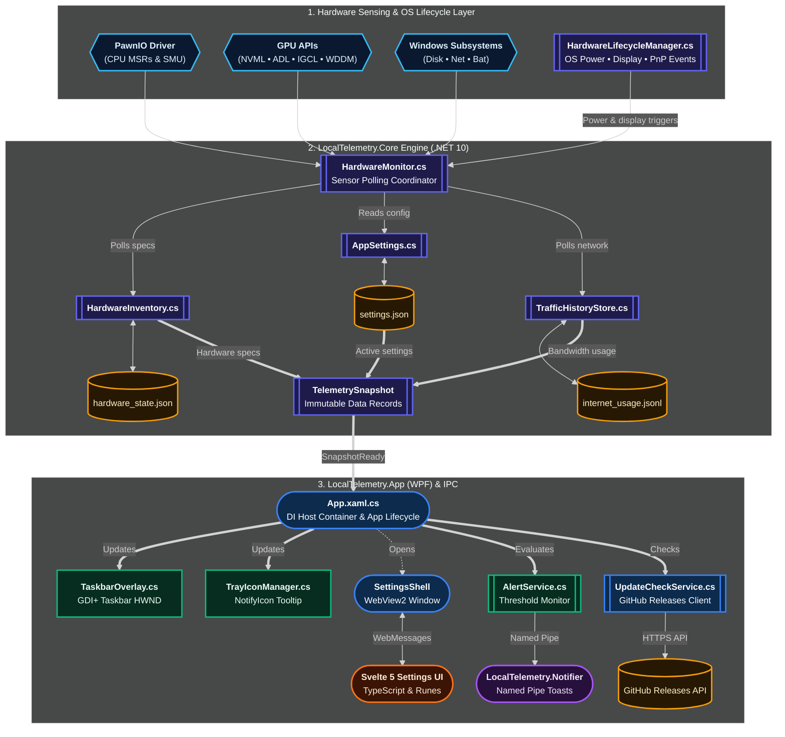

# :cpu: Backend Architecture & Telemetry Engine

This page details the architectural design of the C# backend powering **LocalTelemetry.Core** and **LocalTelemetry.App**.

## :layers: Core Architecture (LocalTelemetry.Core)

`LocalTelemetry.Core` is built as a pure C# .NET 10 class library with zero UI dependencies, allowing hardware monitoring logic to remain completely decoupled, fast, and testable.

### :sliders-horizontal: AppSettings (Configuration Engine)

- Manages user preferences saved in `settings.json`.
- Uses `InitPaths(exeDir)` to inspect for an `app.mode` marker file:
  - If `app.mode` exists (installed mode), data directories point to `%LOCALAPPDATA%\LocalTelemetry`.
  - If absent (portable mode), configuration and log files are stored directly alongside `LocalTelemetry.exe`.
- Implements schema migration (`MigrateConfig`) to cleanly upgrade older settings schemas without losing user preferences.
- Persists configuration to `settings.json`, protecting against corruption via automatic `.corrupt` backup creation and graceful fallback to defaults on load failure.

### :activity: HardwareMonitor (Telemetry Polling Coordinator)

- The central engine coordinating all sensor polling loops on a background worker timer (`100 ms` to `10000 ms`, configured via `AppSettings.Monitoring.PollIntervalMs`).
- Subscribes to `HardwareLifecycleManager` events for power transitions, display changes, and network topology shifts.
- Queries specialized hardware readers on each tick:
  - `IntelMsrReader.cs` & `AmdMsrReader.cs` (via `PawnIo` kernel driver for temperature, clock frequency, and RAPL package power).
  - `IntelPowerGadget.cs` (fallback driver for Intel core temperature and package wattage).
  - `NvGpuMonitor.cs` (NVIDIA NVML P/Invoke bindings).
  - `AmdGpuMonitor.cs` (AMD ADL P/Invoke bindings).
  - `IntelGpuMonitor.cs` (Intel IGCL / ControlLib bindings).
  - `WddmGpuMonitor.cs` (Windows WDDM GPU performance counters via `D3DKMTQueryStatistics`).
  - `System.Diagnostics.PerformanceCounter` (Windows `PhysicalDisk` read/write bytes per second).
  - `NetworkInterface.GetIPv4Statistics()` (Per-tick throughput delta calculation on the active physical network adapter).
  - Battery charge & discharge wattage via WMI `root\wmi:BatteryStatus` and `GetSystemPowerStatus`.
- Produces immutable `TelemetrySnapshot` records dispatched via `SnapshotReady` on every refresh tick.

### :refresh-cw: HardwareLifecycleManager (Dynamic OS & Hardware Lifecycle)

- Implemented in `HardwareLifecycleManager.cs`.
- Listens to native Windows system events (`SystemEvents`) and network availability (`NetworkChange`):
  - **Display & Graphics Resets (`DisplaySettingsChanged` / `WM_DISPLAYCHANGE`):** Debounced (3000 ms) and triggers dynamic refresh of WDDM GPU adapter state.
  - **System Sleep (`PowerModes.Suspend`):** Immediately pauses the background polling timer to eliminate wakeups during standby.
  - **System Resume (`PowerModes.Resume`):** Waits 3 seconds for hardware warm-up, executes `ResetGpuMonitors()` across NVML, WDDM, ADL, and IGCL backends, re-initializes network adapter counters, and resumes polling.
  - **Network Topology Changes (`NetworkAddressChanged` / `NetworkAvailabilityChanged`):** Automatically detects adapter connections, disconnections, and IP address renewals.
  - **PnP Device Changes (`WM_DEVICECHANGE`):** Refreshes storage drive mappings upon USB or NVMe disk hotplugging.

### :test-tube: TestEnvironment (Headless CI & Testing Support)

- Implemented in `TestEnvironment.cs`.
- Detects whether code is executing inside an automated test harness (xUnit, Vitest, or CI runners).
- Provides `IsTestHost()` to prevent driver downloads, kernel service mutations, and UAC elevation prompts during automated test runs.

### :database: MetricSnapshot & TelemetrySnapshot (State Models)

- Represents the complete, immutable point-in-time state of all polled hardware sensors.
- Contains normalized properties for CPU, GPU, RAM, Disk, Network, and Battery telemetry, ensuring UI consumers receive thread-safe, consistent snapshots with zero race conditions.
- See the [C# Core API & Models Reference](reference/core-api.md) for complete property definitions.

### :fingerprint-pattern: HardwareInventory (Component Fingerprinting & Cache)

- Implemented in `HardwareInventory.cs`.
- On application launch, generates an SHA-256 system hardware fingerprint (combining motherboard serial, processor ID, GPU device IDs, RAM module serials, and disk hardware IDs).
- Compares the fingerprint against `%LOCALAPPDATA%\LocalTelemetry\hardware_state.json`:
  - If identical, emits a concise single-line confirmation in diagnostic logs, minimizing disk I/O and startup delay.
  - If changed or on first launch, executes a comprehensive hardware discovery audit and updates the cached state file.

### :hard-drive: DiskQuery & PhysicalDisk Performance Counters

- Rather than relying on fragile kernel drivers for storage, LocalTelemetry uses a hybrid approach:
  - **I/O Rates**: Queried using high-performance Windows `PhysicalDisk` Performance Counters (`\PhysicalDisk(*)\Disk Read Bytes/sec` and `Disk Write Bytes/sec`), tracking both per-disk and system total throughput.
  - **Drive Metadata**: Queried via `DiskQuery.cs` using Win32 storage IOCTLs (`IOCTL_STORAGE_QUERY_PROPERTY`, `IOCTL_VOLUME_GET_VOLUME_DISK_EXTENTS`) and WMI to resolve commercial drive capacities, vendor names, boot drive flags, and bus architectures (`NVMe`, `SATA`, `SCSI`).

### :network: WindowsNetworkUsageProvider & TrafficHistoryStore

- Reads active network adapter traffic statistics and calculates bandwidth deltas.
- Logs daily download, upload, and total usage to `internet_usage.jsonl` via `NetUsageLogger.cs`, `TrafficHistoryFile.cs`, and `TrafficHistoryStore.cs`.
- Backfills historical bandwidth records from the Windows System Resource Usage Monitor (`SRUDB.dat`) database using the Extensible Storage Engine (ESE / `esent.dll`) via `WindowsNetworkUsageProvider.cs`, `EseNetworkUsageReader.cs`, and `DatImporter.cs`.

### :palette: BrandColorDefaults (Hardware Palette Mapper)

- Maintains canonical brand color definitions and alias maps for hardware vendors across CPUs (Intel, AMD), GPUs (NVIDIA, AMD, Intel), RAM, Disks, Network Adapters, and Battery OEMs.
- Automatically maps discovered system components to official brand hex palettes.

### :file-text: Log (Structured Diagnostics & Rotation Engine)

- Zero-external-dependency static logging architecture located in `LocalTelemetry.Core.Diagnostics`:
  - **System Diagnostics Stream (`logs/lt_system.log`)**: Always active. Captures application lifecycle sessions (`SessionStart`, `SessionEnd` with elapsed uptime), driver detection, and system exceptions.
  - **Automatic Size Rotation**: Automatically rolls `lt_system.log` when it reaches 5 MB (`MaxSystemLogBytes = 5MB`), retaining up to 3 numbered archive files (`.1.log`, `.2.log`, `.3.log`).
  - **Midnight Rollover**: Automatically inserts visual calendar separators at midnight (`-- DD-MM-YYYY --`) and smoothly rotates daily metric files.
  - **Daily Metrics Stream (`logs/lt_DD-MM-YYYY.log`)**: Gated by user configuration (`EnableFileLogging` and per-category modes). Emits periodic sensor readings on each tick without blocking the UI.
  - **Thread Safety**: Fully synchronized using non-reentrant private stream locks with automatic flushing (`AutoFlush = true`).

## :app-window: Application Host (LocalTelemetry.App)

`LocalTelemetry.App` is a WPF application targeting .NET 10 Windows x64.

### :terminal: Application Lifecycle & Dependency Injection

- Application entry point implemented in [`App.xaml.cs`](https://github.com/Nicconike/LocalTelemetry/blob/master/src/LocalTelemetry.App/App.xaml.cs). Handles UAC elevation checks (`IsAdministrator()`), relaunching with `Verb = "runas"` and `--elevated` if unelevated.
- Configures the Microsoft Dependency Injection container (`IServiceCollection`).
- Subscribes to `HardwareMonitor.SnapshotReady` to dispatch immutable snapshots to `TaskbarOverlay`, `TrayIconManager`, `AlertService`, and `NetUsageLogger`.
- Manages the process lifecycle of `HardwareMonitor`, `TaskbarOverlay`, `TrayIconManager`, `NotificationClient`, and child daemon `LocalTelemetry.Notifier.exe`.

### :bell: AlertService (Threshold Evaluation & Notifications)

- Evaluates live `TelemetrySnapshot` values against threshold limits defined in `AppSettings.Alerts`.
- Dispatches visual text flashing commands to `TaskbarOverlay`.
- Sends toast notification commands to `NotificationClient.cs` to trigger `LocalTelemetry.Notifier.exe` over Named Pipe IPC.

### :layout-dashboard: SettingsShell (WebView2 Host Window)

- WPF host window managing the Microsoft WebView2 control (`Microsoft.Web.WebView2.Wpf`).
- Binds Svelte 5 frontend build assets (`wwwroot/index.html`) using local virtual folder mapping (`localtelemetry.settings`).
- Implements bidirectional JSON messaging between C# and Svelte via `WebMessageReceived` handlers.
- See the [WebView2 IPC Protocol Reference](reference/ipc-protocol.md) for full message catalogs.

### :refresh-cw: UpdateCheckService (GitHub Releases Client)

- Implemented in `UpdateCheckService.cs`.
- Periodically checks the GitHub Releases API based on configured frequency (`weekly`, `monthly`, or `manual`).
- Parses semantic version strings using a SemVer 2.0 parser that compares major, minor, patch, and pre-release identifiers (`-rc`, `-beta`, `-alpha`).
- Dispatches `updateCheckResult` WebMessages to the Svelte 5 frontend with changelogs and direct download URLs.

## :refresh-cw: Polling Interval Dynamics & Zero-Allocation Pipeline

LocalTelemetry maintains a low CPU and memory footprint (~35-50 MB RAM) by employing a zero-allocation polling strategy:

- Fixed-size reusable byte and string buffers for register and IOCTL reading.
- Double-buffered GDI+ drawing cached directly in unmanaged memory.
- Telemetry timer ticks run on background worker threads without dispatching to the UI thread unless an overlay render tick is due.
