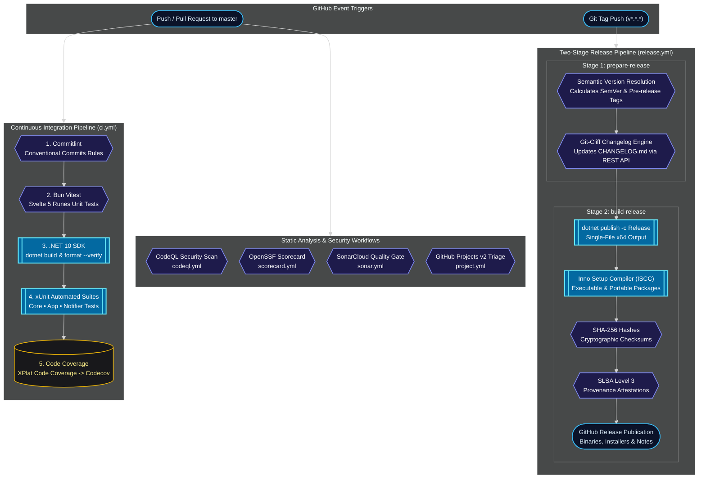

# :rocket: CI/CD Pipelines & GitHub Workflows

LocalTelemetry uses **GitHub Actions** for continuous integration, code quality scanning, automated builds, documentation deployment, project triage, and release packaging.

All workflow actions strictly adhere to OpenSSF Scorecard supply-chain security standards by pinning 40-character commit SHAs.

## :settings: Workflows Breakdown

All workflow definition files are located in `.github/workflows/`:

```cmd
.github/workflows/
├── ci.yml          # Continuous Integration build, format check & unit test pipeline
├── release.yml     # Two-stage Automated Semantic Release, Inno Setup & SLSA Attestation
├── docs.yml        # GitHub Pages documentation build & deployment
├── project.yml     # GitHub Projects v2 automation, triage, sprint & effort assignment
├── codeql.yml      # CodeQL static security analysis
├── scorecard.yml   # OpenSSF Scorecard supply-chain security audit
└── sonar.yml       # SonarQube / SonarCloud static code quality analysis
```



---

## :zap: Continuous Integration Workflow

The continuous integration pipeline is defined in [`.github/workflows/ci.yml`](https://github.com/Nicconike/LocalTelemetry/blob/master/.github/workflows/ci.yml). It triggers on every `push` and `pull_request` targeting the `master` branch.

### 1. Commit Linting (`commitlint`)

Validates commit messages against Conventional Commits rules defined in `commitlint.config.mjs`.

### 2. Frontend Unit Tests (`test-frontend`)

- Installs dependencies using Bun.
- Executes Vitest unit tests in `tests/LocalTelemetry.App.Tests/Settings/wwwroot/`.
- Uploads JUnit test report artifacts.

### 3. Windows Integration & Tests (`test-windows`)

- Compiles the Svelte 5 frontend into `src/LocalTelemetry.App/Settings/wwwroot/dist/`.
- Restores and caches NuGet packages.
- Verifies code formatting with `dotnet format --verify-no-changes`.
- Executes xUnit tests across `LocalTelemetry.Core.Tests`, `LocalTelemetry.App.Tests`, and `LocalTelemetry.Notifier.Tests`.
- Collects test coverage with Coverlet and uploads results to Codecov.

---

## :rocket: Two-Stage Automated Release Pipeline

The release pipeline is defined in [`.github/workflows/release.yml`](https://github.com/Nicconike/LocalTelemetry/blob/master/.github/workflows/release.yml) and uses a two-stage architecture:

### Stage 1: `prepare-release`

1. Evaluates Git tags and commit messages to resolve the next semantic version.
2. Identifies pre-release channels dynamically: if the version string contains `rc`, `beta`, or `alpha`, the release is flagged as a pre-release.
3. Generates release notes with **git-cliff** (`cliff.toml`).
4. Updates `CHANGELOG.md` and commits the changes using the GitHub REST API (`gh api`) with a `[skip ci]` token.

### Stage 2: `build-release`

1. Compiles self-contained, single-file Windows x64 binaries:

   ```cmd
   dotnet publish src/LocalTelemetry.App/LocalTelemetry.App.csproj -c Release -r win-x64 --self-contained true -p:PublishSingleFile=true
   ```

2. Compiles `LocalTelemetrySetup.exe` via Inno Setup 7 (`ISCC.exe`).
3. Generates the portable zip package `LocalTelemetry-win-x64.zip`.
4. Computes SHA-256 hashes into `checksums.txt`.
5. Emits cryptographic SLSA Level 3 build provenance attestations via `actions/attest`.
6. Publishes the release to GitHub Releases with all binaries and checksums attached.

---

## :book-open: Documentation Deployment & Version Locking Workflow

The documentation site deployment pipeline is defined in [`.github/workflows/docs.yml`](https://github.com/Nicconike/LocalTelemetry/blob/master/.github/workflows/docs.yml).

### Triggers

1. Pushes to `master` affecting `docs/**` or `.github/workflows/docs.yml`.
2. Release publication events (`release: types: [published]`).
3. Manual trigger via `workflow_dispatch`.

### Automated Version Locking Process

1. When a new release is published, the workflow triggers automatically.
2. The `actions/checkout` step clones the repository with `fetch-depth: 0` to retrieve all Git tags.
3. The build script `docs/scripts/build-versions.mjs` scans all tags matching `v*` with version `>= v1.0.0-rc.1`.
4. The script extracts immutable markdown documentation from the tagged commit tree into `docs/v<version>/`.
5. It disables edit links (`editLink: false`), rewrites internal cross-references to the versioned path, and updates `docs/.vitepress/versions.mjs`.
6. Bun builds the full VitePress static site containing both the latest docs and all locked release versions.
7. The workflow uploads the artifact and deploys the site to GitHub Pages.

---

## :shield-check: Security & Quality Workflows

- **CodeQL (`codeql.yml`)**: Scans C# and JavaScript/TypeScript code for security vulnerabilities and injection risks.
- **SonarCloud (`sonar.yml`)**: Runs static code analysis and maintains the SonarCloud Clean Code quality gate.
- **OpenSSF Scorecard (`scorecard.yml`)**: Audits supply-chain security, dependency pinning, and branch protections.
- **GitHub Projects Automation (`project.yml`)**: Automates triage, status transitions, sprint planning, and effort sizing in GitHub Projects v2.
