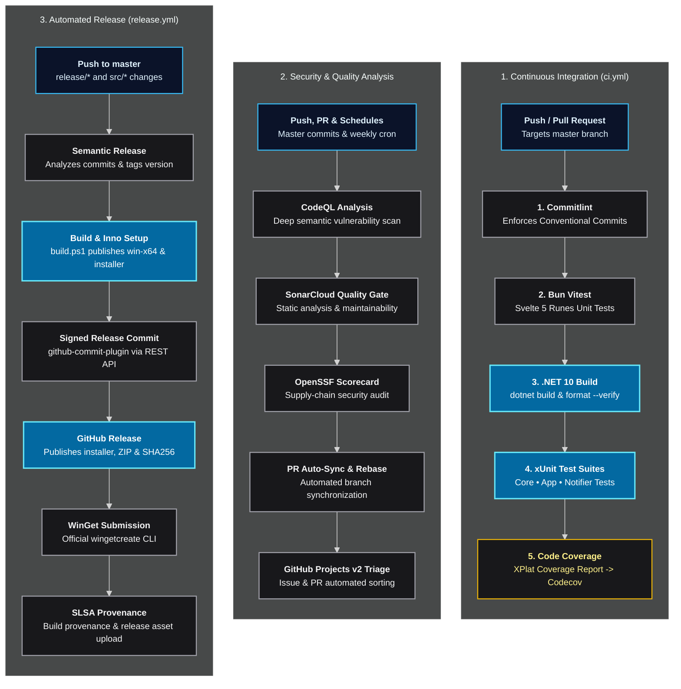

# :rocket: CI/CD Pipelines & GitHub Workflows

LocalTelemetry uses **GitHub Actions** for continuous integration, code quality scanning, automated builds, documentation deployment, project triage, and release packaging.

All workflow actions strictly adhere to OpenSSF Scorecard supply-chain security standards by pinning 40-character commit SHAs.

## :settings: Workflows Breakdown

All workflow definition files are located in `.github/workflows/`:

```cmd
.github/workflows/
├── ci.yml          # Continuous Integration build, format check & unit test pipeline
├── release.yml     # Automated Semantic Release, Inno Setup & SLSA Attestation
├── docs.yml        # GitHub Pages documentation build & deployment
├── sync.yml        # Pull Request branch auto-sync and Dependabot rebase automation
├── project.yml     # GitHub Projects v2 automation, triage, sprint & effort assignment
├── codeql.yml      # CodeQL static security analysis
├── scorecard.yml   # OpenSSF Scorecard supply-chain security audit
└── sonar.yml       # SonarQube / SonarCloud static code quality analysis
```



---

## :zap: Continuous Integration Workflow

The continuous integration pipeline is defined in [`.github/workflows/ci.yml`](https://github.com/Nicconike/LocalTelemetry/blob/master/.github/workflows/ci.yml). It triggers on every `push` and `pull_request` targeting the `master` branch.

### 1. Commit Linting (`commitlint`)

Validates commit messages against Conventional Commits rules defined in `commitlint.config.mjs`.

### 2. Frontend Unit Tests (`test-frontend`)

- Installs dependencies using Bun.
- Executes Vitest unit tests in `tests/LocalTelemetry.App.Tests/Settings/wwwroot/`.
- Uploads JUnit test report artifacts.

### 3. Windows Integration & Tests (`test-windows`)

- Compiles the Svelte 5 frontend into `src/LocalTelemetry.App/Settings/wwwroot/dist/`.
- Restores and caches NuGet packages.
- Verifies code formatting with `dotnet format --verify-no-changes`.
- Executes xUnit tests across `LocalTelemetry.Core.Tests`, `LocalTelemetry.App.Tests`, and `LocalTelemetry.Notifier.Tests`.
- Collects test coverage with Coverlet and uploads results to Codecov.

---

## :rocket: Automated Release Pipeline

The release pipeline is defined in [`.github/workflows/release.yml`](https://github.com/Nicconike/LocalTelemetry/blob/master/.github/workflows/release.yml). It triggers automatically on every push to the `master` branch that modifies release paths or source code:

### Pipeline Execution Flow

1. **GitHub App Authentication**: Generates a GitHub App installation token. The token possesses write permissions for releases, tags, and commits.
2. **Environment Setup**: Fetches all Git tags (`git fetch --tags --force`), sets up Bun and the .NET 10 SDK, and installs release dependencies.
3. **Unified `semantic-release` Runner**:
   - Executes `bun run ./.github/release/run.ts --extends ./.github/release/release.config.mjs`.
   - **Commit Analysis (`@semantic-release/commit-analyzer`)**: Parses Conventional Commits to calculate the next semantic release version (`patch`, `minor`, `major`).
   - **Changelog Generation (`@semantic-release/release-notes-generator` & `@semantic-release/changelog`)**: Groups commits into categorized sections and prepends release notes to `CHANGELOG.md`.
   - **Binary Compilation & Packaging (`@semantic-release/exec`)**:
     - Executes `pwsh -File ./.github/release/build.ps1 -Version "${nextRelease.version}" -Tag "${nextRelease.gitTag}"`.
     - Compiles single-file Windows x64 binaries:

       ```cmd
       dotnet publish src/LocalTelemetry.App/LocalTelemetry.App.csproj -c Release -r win-x64 --no-self-contained -p:PublishSingleFile=true
       ```

     - Compiles `LocalTelemetrySetup.exe` with Inno Setup 7 (`ISCC.exe`).
     - Packages the portable archive `LocalTelemetry-win-x64.zip`.
     - Generates SHA-256 cryptographic hashes in `checksums.txt`.
     - Injects updated version and checksum values into `bucket/localtelemetry.json` and `packaging/winget/localtelemetry.yaml`, and synchronizes package versions.
   - **Repository State Commit (`github-commit-plugin.ts`)**: Uploads file blobs and creates a signed commit via the GitHub REST API. This step updates `master` with web-flow signing and bypasses branch protections cleanly.
   - **Release Publication (`@semantic-release/github`)**: Creates the GitHub Release tag pointing to the new commit. Attaches `LocalTelemetrySetup.exe`, `LocalTelemetry-win-x64.zip`, and `checksums.txt`.
   - **WinGet Package Submission (`wingetcreate`)**:
     - Submits updated metadata to the official Microsoft WinGet Community Repository using Microsoft's official `wingetcreate` CLI utility.
4. **Cryptographic Provenance Attestations**:
   - Generates SLSA Level 3 build provenance attestations for `LocalTelemetrySetup.exe` and `LocalTelemetry-win-x64.zip` via `actions/attest-build-provenance`.
   - Uploads the signed provenance attestation bundle directly to GitHub Release assets using the GitHub CLI (`gh release upload`).

---

## :book-open: Documentation Deployment & Version Locking Workflow

The documentation site deployment pipeline is defined in [`.github/workflows/docs.yml`](https://github.com/Nicconike/LocalTelemetry/blob/master/.github/workflows/docs.yml).

### Triggers

1. Pushes to `master` affecting `docs/**` or `.github/workflows/docs.yml`.
2. Release publication events (`release: types: [published]`).
3. Manual trigger via `workflow_dispatch`.

### Automated Version Locking Process

1. When a new release is published, the workflow triggers automatically.
2. The `actions/checkout` step clones the repository with `fetch-depth: 0` to retrieve all Git tags.
3. The build script `docs/scripts/build-versions.mjs` scans all tags matching `v*` with version `>= v1.0.0-rc.1`.
4. The script extracts immutable markdown documentation from the tagged commit tree into `docs/v<version>/`. It skips versions that are already generated to optimize build performance.
5. It disables edit links (`editLink: false`), rewrites internal cross-references to the versioned path, and updates `docs/.vitepress/versions.mjs`.
6. Bun builds the full VitePress static site containing both the latest docs and all locked release versions.
7. The workflow uploads the artifact and deploys the site to GitHub Pages.

---

## :shield-check: Security & Quality Workflows

- **CodeQL (`codeql.yml`)**: Scans C# and JavaScript/TypeScript code for security vulnerabilities and injection risks.
- **SonarCloud (`sonar.yml`)**: Runs static code analysis and maintains the SonarCloud Clean Code quality gate.
- **OpenSSF Scorecard (`scorecard.yml`)**: Audits supply-chain security, dependency pinning, and branch protections.
- **GitHub Projects Automation (`project.yml`)**: Automates triage, status transitions, sprint planning, and effort sizing in GitHub Projects v2.
