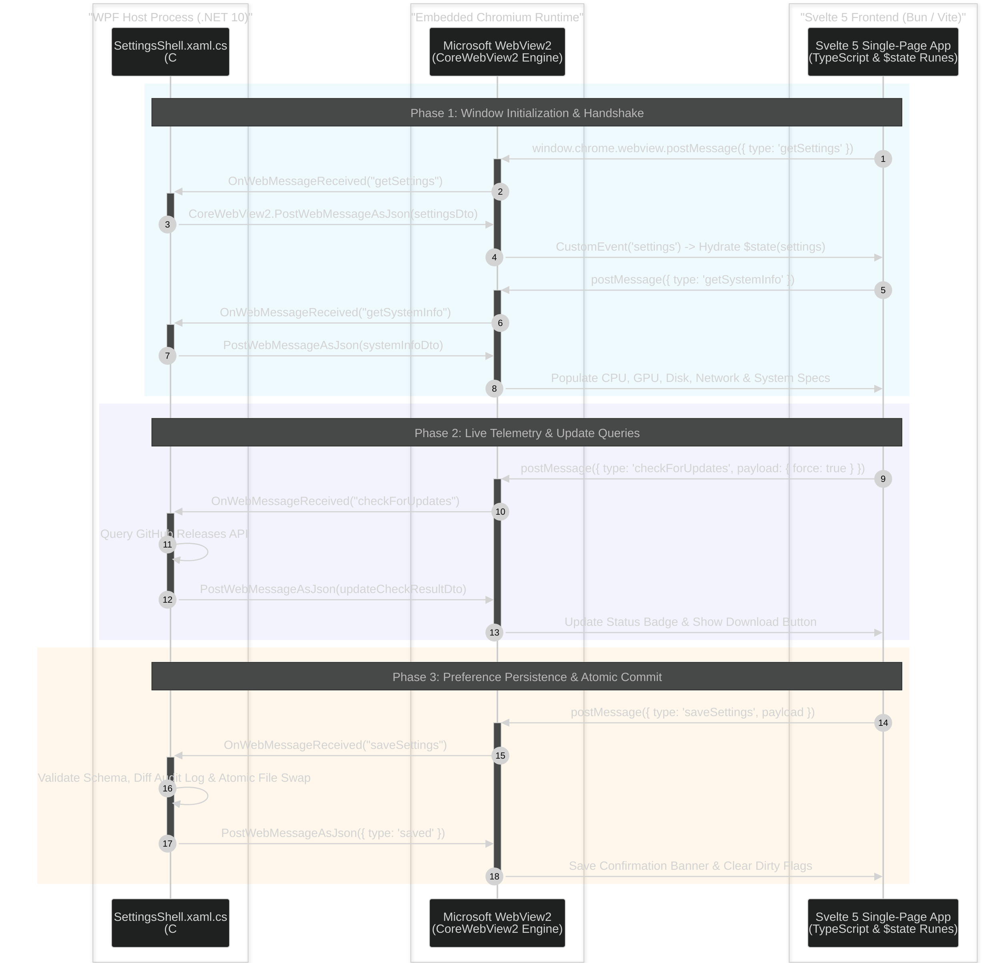

# :palette: Svelte 5 Frontend & WebView2 Bridge

LocalTelemetry's settings interface is built using **Svelte 5 Runes**, **Vite**, **TypeScript**, and **Bun** hosted inside a native Microsoft WebView2 control.

## :settings: Tech Stack & Tooling

- **Framework**: Svelte 5 (using modern runes: `$state()`, `$derived()`, `$effect()`)
- **Build Tool**: Vite (`vite.config.js`)
- **Package Manager**: **Bun** (`bun install`, `bun run build`)
- **CSS**: Scoped CSS custom properties & dark theme tokens (`app.css`, `themes.ts`)

> [!CAUTION]
> **No Legacy Svelte Syntax**: Always use Svelte 5 runes (`$state`, `$derived`, `$effect`). Do NOT use legacy Svelte 3/4 reactive declarations (`$:`) or `export let` syntax.

---

## :radio: WebView2 Bidirectional IPC Bridge

Communication between the C# WPF host (`SettingsShell.xaml.cs`) and the Svelte 5 frontend occurs asynchronously via WebView2 JSON WebMessages.



---

## :bridge: IPC Bridge Message Catalog Summary

The WebView2 bridge supports 11 inbound requests from JavaScript and 10 outbound responses/events from C#:

### :log-in: Inbound Messages (Frontend `postMessage` -> C# Host)

| Message Type | Payload Structure | Description |
| :--- | :--- | :--- |
| `getSettings` | None | Requests the current application settings DTO. |
| `saveSettings` | `SettingsDto` | Submits modified settings for diff logging and persistence to `settings.json`. |
| `getNics` | None | Requests the list of active physical network adapters. |
| `getTrafficMonths` | None | Requests distinct months available in the bandwidth database. |
| `getSystemInfo` | None | Requests hardware specifications and diagnostic details. |
| `openUrl` | `{ url: string }` | Safely opens an HTTP/HTTPS URL or `ms-settings:` URI. |
| `openFolder` | `{ target: "app" \| "data" \| "logs" }` | Opens the install folder, data folder, or logs folder in Explorer. |
| `getTrafficHistoryAll` | None | Requests all historical network usage records and today's total. |
| `importDat` | `{ content: string }` | Imports `.jsonl` backup files or legacy plaintext `.dat` bandwidth logs. |
| `importWindowsUsage` | `{ startDate: string, endDate: string }` | Direct JET/ESE database extraction from Windows `SRUDB.dat`. |
| `checkForUpdates` | `{ force: boolean }` | Triggers a GitHub Releases update query (forced or cached). |

### :log-out: Outbound Messages (C# Host `PostWebMessageAsJson` -> Frontend)

| Message Type | Payload Structure | Description |
| :--- | :--- | :--- |
| `settings` | `SettingsDto` | Supplies current configuration and runtime taskbar slot constraint status to the Svelte store. |
| `saved` | `{ error?: string }` | Confirms successful settings persistence or reports an error. |
| `nics` | `string[]` | Active network adapter names and hardware descriptions. |
| `systemInfo` | `SystemInfoDto` | Full CPU, GPU, RAM, Disk, PSU, and Battery specifications (including health, wear, cycles, and RAM SPD rating). |
| `trafficHistoryAll` | `{ records, todayDown, todayUp }` | Full historical bandwidth records and live daily totals. |
| `trafficToday` | `{ downBytes, upBytes }` | Real-time 5-second bandwidth counter update. |
| `trafficMonths` | `string[]` | Available month strings formatted as `YYYY-MM`. |
| `importDatResult` | `{ daysImported, error? }` | Reports count of imported records or error message. |
| `windowsUsageImportResult` | `{ success, daysImported, downBytes, upBytes, message }` | Reports count of imported ESE database records and byte totals. |
| `updateCheckResult` | `UpdateCheckResultDto` | Update availability status, latest version tag, and release URL. |

::: tip Protocol Reference
For full JSON schema payloads, field-by-field definitions, and TypeScript interfaces, see the [WebView2 & Named Pipe IPC Protocol Reference](reference/ipc-protocol.md).
:::

---

## :terminal: SettingsShell WPF Host Integration

The WPF host (`SettingsShell.xaml.cs`) initializes WebView2 with a virtual host mapping to isolate frontend assets:

- **Virtual Host Domain**: Mapped via `SetVirtualHostNameToFolderMapping("localtelemetry.settings", wwwRoot, DenyCors)`.
- **Navigation Target**: Loaded from `https://localtelemetry.settings/index.html`.
- **Dropdown Blur Guard**: Moving or dragging the window triggers `document.activeElement?.blur()` in JavaScript to prevent detached native combobox popups.
- **Title Bar Diagnostics**: Periodically computes LocalTelemetry's own process CPU utilization and displays it in the window title.

---

## :folder-tree: Frontend Component Hierarchy

The frontend is located at `src/LocalTelemetry.App/Settings/wwwroot/`:

```bash
src/LocalTelemetry.App/Settings/wwwroot/
├── src/
│   ├── components/
│   │   ├── App.svelte                # Root UI shell & WebView2 message listener
│   │   ├── Sidebar.svelte            # Sidebar tab navigation menu
│   │   ├── pages/                    # 10 Dedicated Settings Pages
│   │   │   ├── GeneralPage.svelte    # Autostart, polling interval & units
│   │   │   ├── MonitoringPage.svelte # Hardware component sensor toggles
│   │   │   ├── OverlayPage.svelte    # Taskbar overlay placement, offsets, opacity & space constraint banner
│   │   │   ├── LayoutPage.svelte     # Metric drag-and-drop reordering
│   │   │   ├── NetworkPage.svelte    # Active adapter selection & traffic logging toggle
│   │   │   ├── TrafficHistoryPage.svelte # Daily network calendar heatmap, .jsonl backup & .dat import
│   │   │   ├── AlertsPage.svelte     # Threshold limits & toast settings
│   │   │   ├── SystemPage.svelte     # Hardware summary & specs overview
│   │   │   ├── AppearancePage.svelte # Window themes & metric color pickers
│   │   │   └── AboutPage.svelte      # Version info, update checker, licenses & links
│   │   └── ui/                       # Reusable UI controls
│   │       ├── MetricChip.svelte     # Metric badge / chip display
│   │       ├── SectionCard.svelte    # Card container with section header
│   │       ├── Select.svelte         # Custom themed select dropdown
│   │       ├── Slider.svelte         # Range slider input
│   │       └── Toggle.svelte         # Animated boolean toggle switch
│   ├── lib/
│   │   ├── bridge.ts                 # WebView2 postMessage wrapper functions
│   │   ├── store.ts                  # Svelte 5 reactive stores ($state)
│   │   ├── themes.ts                 # Color themes & CSS token injector
│   │   ├── types.ts                  # TypeScript interfaces matching C# DTOs
│   │   └── utils.ts                  # Utility formatting helpers (bytes, dates)
│   ├── app.css                       # Global styles & theme custom properties
│   ├── main.ts                       # Svelte 5 application mount entry point
│   ├── vite-env.d.ts                 # Vite client type definitions
│   └── webview.d.ts                  # Microsoft WebView2 JavaScript API declarations
├── index.html                        # Single-page application HTML entry
├── package.json                      # Frontend dependencies & Bun build scripts
├── svelte.config.js                  # Svelte 5 compiler configuration
├── tsconfig.json                     # TypeScript compiler configuration
└── vite.config.js                    # Vite build configuration (base: './')
```
