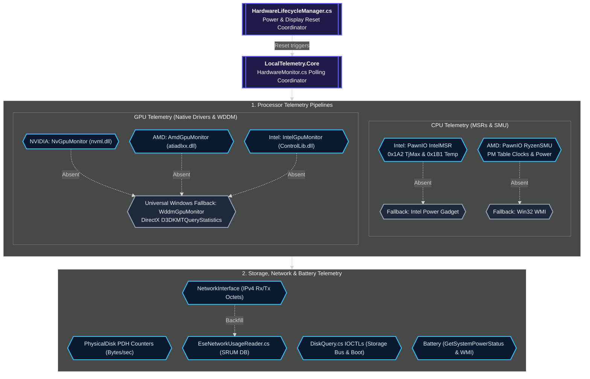

# :cpu: Hardware Sensor Architecture & Driver Implementation

LocalTelemetry reads low-level hardware registers directly from kernel drivers, vendor-provided dynamic link libraries, and Windows performance counters.

## :layers: Hardware Sensor Architecture



## :file-text: Hardware Sensor Sources Summary

| Metric Category | Primary API Source | Fallback / Alternative |
| :--- | :--- | :--- |
| **CPU Usage** | `GetSystemTimes` (Win32 kernel32 API) | Per-core `\Processor Information(*)\% Processor Utility` (PDH) |
| **CPU Temperature** | `PawnIO IntelMSR` (MSR `0x1B1` / `0x1A2`) | `PawnIO RyzenSMU` (AMD PM Table) / `IntelPowerGadget.cs` |
| **CPU Frequency** | `PawnIO APERF/MPERF` MSR delta | `IntelPowerGadget.cs` (live clocks) / `CallNtPowerInformation` baseline |
| **CPU Package Power** | RAPL Energy Status MSRs (`0x606` / `0x611`) | `IntelPowerGadget.cs` / Estimated TDP calculation |
| **RAM Usage** | `GlobalMemoryStatusEx` (Win32 API) | N/A |
| **GPU Utilization** | `NVML` (NVIDIA) / `ADL` (AMD) / `IGCL` (Intel) | `WddmGpuMonitor.cs` (WDDM Engine Counters via D3DKMT) |
| **GPU Temperature** | `nvmlDeviceGetTemperature` | `ADL_Overdrive6_Temperature_Get` / IGCL |
| **GPU VRAM Usage** | `nvmlDeviceGetMemoryInfo` | ADL VRAM queries / WDDM VRAM Counters |
| **Disk Throughput** | `\PhysicalDisk(*)\Disk Read & Write Bytes` | `DiskQuery.cs` (Win32 IOCTLs) |
| **Network Speeds** | `NetworkInterface.GetIPv4Statistics()` delta | `EseNetworkUsageReader.cs` (Windows ESE SRUDB database) |
| **Battery Level & W** | `GetSystemPowerStatus` & `root\wmi` | N/A (Desktop systems return empty / disabled) |

---

## :shield: Kernel Access with PawnIo

### :cpu: PawnIo Driver Architecture & Micro-Scripts

To read CPU package temperatures, MSR (Model-Specific Register) values, and AMD Ryzen SMU metrics, LocalTelemetry utilizes the **PawnIo** kernel driver interface located in [`src/LocalTelemetry.Core/Hardware/PawnIo/`](https://github.com/Nicconike/LocalTelemetry/tree/master/src/LocalTelemetry.Core/Hardware/PawnIo):

- **Silent Elevation Setup**: `PawnIoDevice.TryInstall` executes `PawnIO_setup.exe -install -silent` and configures the `PawnIO` kernel service. Because the host process is elevated at launch via `app.manifest`, the installation runs without prompting for additional UAC confirmations.
- **Embedded Binary Scripts (`.bin` Resources)**:
  `LocalTelemetry.Core` embeds pre-compiled PawnIO hardware definition micro-scripts uploaded to the driver on initialization:
  - `AMDFamily0F.bin`, `AMDFamily10.bin`, `AMDFamily17.bin`: AMD CPU family models and MSR/SMU routines
  - `RyzenSMU.bin`: Ryzen SMU mailbox interface for Zen 2, Zen 3, Zen 4, and Zen 5 architectures
  - `IntelMSR.bin`, `IntelMCHBAR.bin`: Intel MSR and memory controller hub BAR access
  - `IntelOOBMSM.bin`, `IntelPCHThermal.bin`: Intel Out-of-Band management and PCH thermal sensors
  - `DellSMM.bin`: Dell System Management Mode fan and thermal controls
  - `IsaBridgeEC.bin`, `LpcCrOSEC.bin`, `LpcIO.bin`: Embedded Controller (EC) and Super I/O chip access
  - `SmbusI801.bin`, `SmbusIntelSkylakeIMC.bin`, `SmbusNCT6793.bin`, `SmbusPIIX4.bin`: SMBus controller interfaces

### :binary: Driver Handle Management & IOCTL Dispatch

- Transport communication occurs via `DeviceIoControl` with Windows kernel driver handles (`\\.\PawnIO`).
- Handles are safely wrapped in disposable abstractions (`IPawnIoTransport`) and closed during application shutdown to avoid leaving dangling driver locks.

---

## :flame: CPU Telemetry: Intel vs AMD

### :microchip: CPU Architecture Detection

At startup, `HardwareMonitor.cs` inspects the processor vendor string via CPUID instruction queries to route queries to dedicated readers:

- `GenuineIntel`: Routes to `IntelMsrReader.cs` and `IntelPowerGadget.cs`
- `AuthenticAMD`: Routes to `AmdMsrReader.cs`

### :calculator: Intel Package Temperature & TjMax (MSR 0x1A2 & 0x1B1)

In `IntelMsrReader.cs`, Intel processor temperatures are computed using package-level thermal status:

1. **Target Temperature (`MSR_IA32_TEMPERATURE_TARGET` = `0x1A2`)**:
   Reads target junction limit:

   ```csharp
   int tjMax = (int)((tjTarget >> 16) & 0xFF);
   ```

2. **Package Thermal Status (`MSR_IA32_PACKAGE_THERM_STATUS` = `0x1B1`)**:
   Reads digital readout delta relative to TjMax:

   ```csharp
   int digitalReadout = (int)((thermStatus >> 16) & 0xFF);
   ```

3. **Current Package Temperature**:
   $$\text{Temperature (°C)} = \text{tjMax} - \text{digitalReadout}$$

### :zap: AMD Ryzen SMU & Power Management Table (PM Table)

In `AmdMsrReader.cs`, AMD Ryzen CPU temperature is read by resolving and walking the power management table:

1. Calls `ioctl_resolve_pm_table` to locate the SMU PM table structure in memory.
2. Invokes `ioctl_update_pm_table` to refresh telemetry data.
3. Calls `ioctl_read_pm_table` across `PM_TABLE_ENTRY_COUNT = 128` entries, decoding valid temperature readings with `TryDecodeTemperature` and returning the highest active package temperature.

---

## :refresh-cw: Dynamic GPU Reset & TDR Recovery

When Windows display adapters restart (e.g. driver update, GPU TDR recovery, or waking from sleep), hardware monitors must re-initialize without crashing the host process:

- `HardwareMonitor.cs` implements `ResetGpuMonitors(string reason)`:
  - `_nvGpu?.Reset()`: Re-initializes NVML handles and device contexts.
  - `_wddmGpu?.Reset()`: Flushes cached D3DKMT adapter handles and re-queries adapter statistics.
  - `_amdGpu?.Reset()`: Rebinds ADL context.
  - `_intelGpu?.Reset()`: Rebinds Intel ControlLib context.
- When waking from system standby, `HardwareLifecycleManager` delays recovery by `3000 ms` to allow PCIe buses and graphics drivers to reach operational power states before querying registers.

---

## :hard-drive: Disk Telemetry: Performance Counters & IOCTL Storage Queries

### :activity: PhysicalDisk Performance Counters (I/O Rates)

- Read and write speeds are polled directly through Windows `PhysicalDisk` Performance Counters:
  - `\PhysicalDisk(_Total)\Disk Read Bytes/sec` & `Disk Write Bytes/sec`
  - Per-disk instance counters: `\PhysicalDisk(0 C:)\...`, `\PhysicalDisk(1 D:)\...`
- Disks are registered dynamically in `Metrics.RegisterDisk("disk0", "DISK0")` to allow per-drive layout customization.

### :hard-drive: Win32 Storage IOCTL & Boot Drive Detection (DiskQuery)

- `DiskQuery.cs` queries physical drive descriptors:
  - `IOCTL_STORAGE_QUERY_PROPERTY`: Queries storage bus type (`NVMe`, `SATA`, `SCSI`, `USB`), device media type (SSD vs HDD), and vendor labels.
  - `IOCTL_VOLUME_GET_VOLUME_DISK_EXTENTS`: Maps logical Windows drive letters (`C:`, `D:`) to underlying physical disk indices.
  - Resolves the official Windows `Boot` drive badge.
  - Standardized display labels: single drive of a type displays without an index (`NVMeR`, `SATAR`), while multiple drives append a 1-based index (`NVMe1R`, `NVMe2R`, `SATA1W`).

---

## :network: Historical Bandwidth Extraction (EseNetworkUsageReader)

- `EseNetworkUsageReader.cs` queries the Windows System Resource Usage Monitor database (`C:\Windows\System32\sru\SRUDB.dat`).
- Uses the native Windows Extensible Storage Engine (`esent.dll`) P/Invoke interface:
  - Attaches to the database in read-only recovery mode.
  - Scans table `{973F5D5C-1D90-4944-BE8E-24B94231A174}` for network interface data usage.
  - Maps interface GUIDs to physical adapter names.
  - Feeds historical daily upload and download octets into `TrafficHistoryStore.cs` for calendar display.

---

## :battery-charging: Battery Telemetry: Win32 & WMI Subsystems

- **Charge State & Level**: Samples remaining battery percentage and AC power connection status via `GetSystemPowerStatus`.
- **Real-Time Charge / Discharge Rate**: Queries WMI `root\wmi:BatteryStatus` to sample remaining milliwatt-hours (`mWh`). Delta over time intervals calculates real-time rate in Watts (`W`).
- **Hardware Metadata Extraction**: Inspects WMI `root\wmi:BatteryStaticData` and `Win32_Battery` to extract authentic manufacturer name, device model, designed capacity, and full charge capacity.
- **Virtual Battery Filtering**: Automatically filters out virtual battery stubs (e.g. `-Virtual Battery 0-`, `CRB Battery 0`), prioritizing physical battery hardware.

---

## :shield-check: Driver Security & Cleanup Protocols

- **Driver Whitelist Verification**: All binary scripts uploaded to `PawnIO` are signed embedded resources compiled directly into `LocalTelemetry.Core.dll`.
- **Driver Uninstallation & DriverStore Removal**:
  - The Inno Setup uninstaller and portable `Uninstall.bat` invoke `pnputil.exe /delete-driver <oem.inf> /uninstall /force` to purge `pawnio.inf` from the Windows DriverStore.
  - If Windows reports that the kernel driver handle is locked in memory (exit code `3010`), the user is prompted to restart the system before reinstalling.
