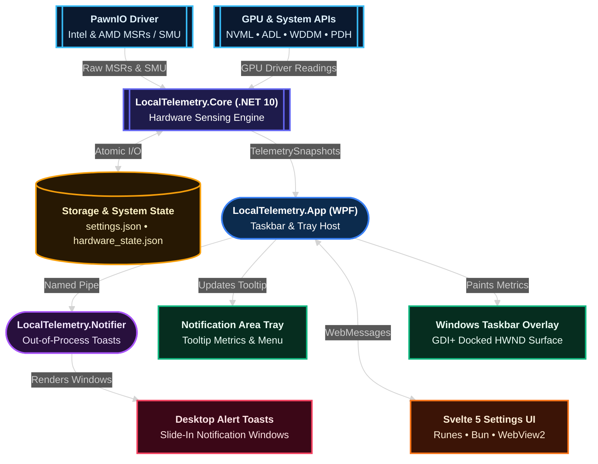

# :code-xml: Developer Guide & Architecture

Welcome to the **LocalTelemetry Developer & Contributor Guide**!

Welcome to the **LocalTelemetry Developer Guide**. This documentation covers system architecture, hardware sensor drivers, Win32 taskbar integration, IPC protocols, and automated build pipelines.

## :layers: High-Level System Architecture

LocalTelemetry is composed of three main C# / .NET 10 projects, three automated test suites, and an embedded Svelte 5 frontend:

## :map: Guide Roadmap & Subsystems

### :microchip: Hardware Sensing & Kernel Drivers

- **Responsibility**: Low-level processor register reading via `PawnIO` (Intel MSRs, AMD Ryzen SMU PM table), vendor GPU interfaces (NVML, ADL, ControlLib), WDDM GPU counters, and Win32 disk queries (`DiskQuery.cs`).

### :localtelemetry: C# Monitoring Engine

- **Responsibility**: Hardware monitoring coordinator (`HardwareMonitor.cs`), component fingerprinting (`HardwareInventory.cs`), network traffic store (`TrafficHistoryStore.cs`), and JSON configuration persistence (`AppSettings.cs`).

### :layout-dashboard: Win32 Taskbar Hook & Transparent Overlay

- **Responsibility**: High-performance GDI+ render surface embedded into Windows taskbar (`Shell_TrayWnd`), 5-second watchdog timer, 200ms repositioning loop, and low-level mouse hooking (`WH_MOUSE_LL`).

### :globe: Svelte 5 & WebView2 Settings UI

- **Responsibility**: Modern dark-mode configuration UI built with Svelte 5 runes (`$state`, `$derived`, `$effect`), Vite, Bun, and TypeScript. Communicates with WPF via bidirectional `window.chrome.webview` JSON WebMessages.

### :bell: Toast Notifier IPC Pipe Subsystem

- **Responsibility**: Standalone out-of-process toast helper (`LocalTelemetry.Notifier.exe`) communicating via Named Pipes (`LocalTelemetryNotifier`) with focus-safe window styles (`WS_EX_NOACTIVATE`).

### :package: Build System, Inno Setup & CI/CD

- **Responsibility**: Automated MSBuild packaging, Inno Setup 7 bootstrapper installer (`setup.iss`), portable cleanup tools (`Uninstall.bat`), and 8 GitHub Actions workflows adhering to OpenSSF Scorecard standards.

## :wrench: Subsystem Directory Reference

| Directory / Project | Language / Platform | Primary Responsibilities |
| :--- | :--- | :--- |
| `src/LocalTelemetry.Core` | C# 13 / .NET 10 | Hardware sensors, PawnIo MSR/SMU reader, `DiskQuery`, `HardwareInventory`, network logging |
| `src/LocalTelemetry.App` | C# 13 / WPF / WebView2 | Host window, Taskbar overlay docking, system tray icon, alerts, settings shell |
| `src/LocalTelemetry.Notifier` | C# 13 / WinForms | Out-of-process toast notifications, named pipe server, cubic ease-out slide-in animations |
| `src/.../Settings/wwwroot` | Svelte 5 / TypeScript | Single-page settings panel application, themes, stores, WebView2 IPC bridge |
| `tests/LocalTelemetry.Core.Tests` | C# / xUnit | Automated unit testing for hardware sensors, disk queries, inventory, models, and config |
| `tests/LocalTelemetry.App.Tests` | C# & Vitest | Unit tests for alert service, Win32 embedder, tray manager, and Svelte components |
| `tests/LocalTelemetry.Notifier.Tests` | C# / xUnit | Automated testing for pipe server, notifier logging, and toast forms |
| `docs/` | VitePress / Markdown | Technical documentation site, Lucide icon extensions, version switcher |

## :lightbulb: Recommended Reading Paths

### :cpu: Hardware & Kernel Subsystems

1. [**Hardware Sensor Architecture & Driver Implementation**](./hardware-drivers.md): Deep dive into PawnIo MSR registers, Ryzen SMU PM table resolution, and Win32 disk IOCTLs.
2. [**Backend Architecture & Telemetry Engine**](./backend-architecture.md): Exploration of `HardwareMonitor.cs`, `SystemInfo.cs`, and `HardwareInventory.cs`.

### :monitor: Windows UI & System Interop

1. [**Taskbar Overlay & Win32 Interop**](./taskbar-overlay-interop.md): Win32 `SetParent` reparenting, taskband shrinking, layered floating window fallback, and Explorer crash recovery.
2. [**Toast Notifier & Inter-Process Communication (IPC)**](./notifier-ipc.md): Process isolation, named pipe IPC, and non-blocking toast animations.

### :code-xml: Frontend & Application Configuration

1. [**Frontend Architecture & WebView2 Integration**](./frontend-webview.md): Svelte 5 runes architecture, reactive stores, CSS variables, and bidirectional JSON message catalogs.
2. [**Contributing & Coding Standards**](./contributing.md): Pull request requirements, Conventional Commits, and brand color palettes.

### :bookmark: Reference & Technical Specifications

1. [**C# Core API & Telemetry Models**](./reference/core-api.md): Public types, sensor monitor interfaces, hardware inventory models, and logging APIs.
2. [**IPC Protocols & WebMessage Specifications**](./reference/ipc-protocol.md): JSON contract specifications for WebView2 communication and Named Pipe toast payloads.
3. [**settings.json Configuration Schema**](./reference/settings-schema.md): Configuration file schema, default values, and data type specifications.

## :book-open: Developer Guide Navigation

- [**Development Environment Setup**](./setup.md): Tools, SDKs, and step-by-step commands to build the project locally
- [**Repository Structure**](./repository-structure.md): Detailed directory map of the solution, source code, and tests
- [**Backend Architecture & Telemetry Engine**](./backend-architecture.md): In-depth look at `AppSettings.cs`, `HardwareMonitor.cs`, `HardwareInventory.cs`, and `SystemInfo.cs`
- [**Hardware Drivers & Sensor Polling**](./hardware-drivers.md): Detailed hardware register mappings, MSRs, NVML, ADL, PDH, and PawnIo
- [**Win32 Taskbar Hooking & Overlay Interop**](./taskbar-overlay-interop.md): Deep dive into `SetParent` reparenting, taskband shrinking, layered floating fallback, and Explorer recovery
- [**Svelte 5 Frontend & WebView2 Bridge**](./frontend-webview.md): Svelte 5 runes architecture and bidirectional C# <-> JS JSON messaging sequence
- [**Toast Notifier & Inter-Process Communication (IPC)**](./notifier-ipc.md): Named Pipe IPC protocol, `HiddenForm` message pump, and cubic ease-out slide-in animations
- [**C# Core API & Telemetry Models**](./reference/core-api.md): Public classes, sensor interfaces, inventory data structures, and logging methods
- [**IPC Protocols & WebMessage Specifications**](./reference/ipc-protocol.md): Complete message schemas for WebView2 RPC and Named Pipe notifications
- [**settings.json Configuration Schema**](./reference/settings-schema.md): Exhaustive JSON schema definition for application configuration
- [**Building & Packaging**](./building-and-packaging.md): Compiling single-file executables, Inno Setup 7 installer scripts, and portable ZIPs
- [**CI/CD Pipelines & GitHub Workflows**](./ci-cd.md): Breakdown of all 8 GitHub Actions workflows, OpenSSF 40-character SHA pinning, and SLSA attestations
- [**Contributing & Coding Standards**](./contributing.md): C# 13 standards, conventional commits, PR guidelines, and brand color additions
