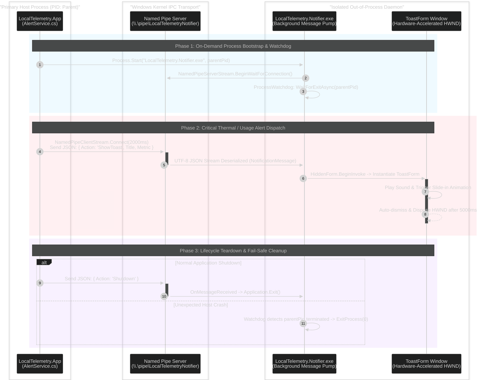

# :radio: Standalone Notifier IPC Subsystem

**LocalTelemetry.Notifier** is a standalone, lightweight WinForms executable (`LocalTelemetry.Notifier.exe`) targeting .NET 10 Windows x64, dedicated to rendering non-blocking desktop toast alert windows.

## :shield-question-mark: Why a Standalone Process?

Rendering alert windows with slide-in animations and auto-dismiss timers inside the main application process carries two key risks:

1. **Focus Stealing**: Window activation during full-screen gaming or video playback could cause games to lose keyboard focus or minimize to desktop
2. **UI Thread Blocking**: Animation loops on the main UI thread could delay telemetry sensor polling ticks

By spinning up `LocalTelemetry.Notifier.exe` as a secondary process, notifications display smoothly without stealing foreground focus or blocking hardware monitoring threads.

## :audio-lines: Named Pipe IPC Communication

`LocalTelemetry.App` launches `LocalTelemetry.Notifier.exe` passing its **Parent Process ID (PID)** as `args[0]`. Inter-process communication takes place over an asynchronous Windows **Named Pipe** (`LocalTelemetryNotifier`).



## :recycle: On-Demand Process Lifecycle

To conserve system resources, `LocalTelemetry.Notifier.exe` is **not** kept running unconditionally. `App.xaml.cs` dynamically controls the process lifecycle:

- **`EnsureNotifierLaunched()`**: Invoked on startup or when the user enables threshold alerts with toast notifications in Settings. Launches the executable with the current process ID as `args[0]`.
- **`EnsureNotifierStopped()`**: Invoked when alerts or toast notifications are disabled in Settings, or when LocalTelemetry is closing. Dispatches a `Shutdown` IPC message over the named pipe and waits up to 2 seconds for a clean shutdown before terminating the process.

### :file-code: JSON Message Contract (`NotificationMessage`)

`NotificationClient.cs` serializes messages over the pipe in UTF-8 JSON Lines format:

```json
{
    "Action": "ShowToast",
    "Title": "CPU Temperature Warning",
    "Body": "CPU reached 88°C (Limit: 85°C)",
    "Tag": "cpu_temp"
}
```

```csharp
private sealed record NotificationMessage
{
    public string Action { get; set; } = string.Empty;
    public string? Title { get; set; }
    public string? Body { get; set; }
    public string? Tag { get; set; }
}
```

### :terminal: Command Actions

- `ShowToast`: Triggers `ToastForm` rendering on screen with `Title` and `Body`
- `Shutdown`: Gracefully cancels `CancellationTokenSource` and closes `HiddenForm`

## :hat-glasses: Hidden Message Pump (`HiddenForm`)

Inside `Program.cs`, an invisible `HiddenForm` provides a WinForms message pump:

- Hidden from Alt+Tab via `WS_EX_TOOLWINDOW` (`0x00000080`) extended window style
- `ShowInTaskbar = false`, `WindowState = Minimized`, `Opacity = 0`
- Receives pipe messages on a background thread (`RunPipeServerAsync`) and dispatches toast creation to the UI thread via `hiddenForm.BeginInvoke(...)`

## :mop-sparkles: Toast Window Rendering & Animation

Implemented in [`ToastForm.cs`](https://github.com/Nicconike/LocalTelemetry/blob/master/src/LocalTelemetry.Notifier/ToastForm.cs), the window renders a custom dark alert popup:

- **Dimensions**: `320px` width × `90px` height.
- **Appearance**: Dark background (`Color.FromArgb(32, 32, 32)`), rounded corners (`CornerRadius = 8` via `GraphicsPath`), border pen (`Color.FromArgb(60, 60, 60)`).
- **Audio Cue**: Plays system asterisk sound (`SystemSounds.Asterisk.Play()`).
- **Ease-Out Slide-In Animation**: `OnLoad` animates the window position from below the screen working area using a cubic ease-out curve (`1.0 - Math.Pow(1.0 - t, 3)`) over `300ms`.
- **Auto-Dismiss**: A `System.Windows.Forms.Timer` automatically closes the toast window after `5000ms`.

## :square-arrow-right-exit: Parent Process Monitoring & Auto-Exit

When `LocalTelemetry.Notifier.exe` receives `parentPid` as `args[0]`:

1. Launches a background worker task: `Process.GetProcessById(parentPid).WaitForExitAsync()`.
2. When the parent `LocalTelemetry.exe` process exits, the notifier process automatically logs exit and shuts down cleanly.

## :file-text: Notifier Diagnostic Logging

Implemented in [`NotifierLog.cs`](https://github.com/Nicconike/LocalTelemetry/blob/master/src/LocalTelemetry.Notifier/NotifierLog.cs), `LocalTelemetry.Notifier` records its operational lifecycle, named pipe connections, and toast animations directly to `lt_notifier.log`:

- **File Location**: Uses the identical directory resolution rule as `AppSettings` (located in `%LOCALAPPDATA%\LocalTelemetry\lt_notifier.log` in standard mode, or alongside the executable in portable mode).
- **Clean Shutdown**: `NotifierLog.Shutdown()` flushes buffered log entries to disk when the message pump exits.
