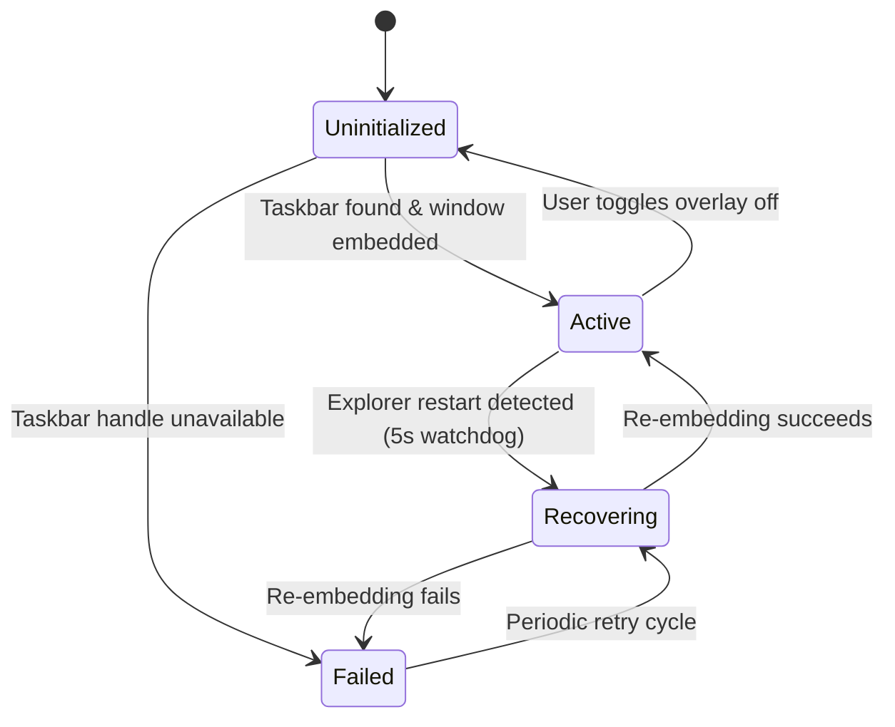

# :cpu: C# Core API & Domain Models Reference

This document describes the public classes, interfaces, enums, and data contracts in `LocalTelemetry.Core`.

All components target **.NET 10** on Windows x64.

---

## :layers: Hardware Lifecycle Subsystem

### `IHardwareLifecycleManager`

- **Namespace:** `LocalTelemetry.Core.Hardware`
- **Implements:** `IDisposable`

Defines the contract to monitor Windows system events, power transitions, display changes, and device hotplug events.

```csharp
namespace LocalTelemetry.Core.Hardware;

public interface IHardwareLifecycleManager : IDisposable
{
    event Action? DisplayOrDriverChanged;
    event Action? PowerSuspended;
    event Action? PowerResumed;
    event Action? NetworkTopologyChanged;
    event Action? DevicePnPChanged;

    void NotifyDisplayChanged();
    void NotifyDevicePnPChanged();
}
```

### `HardwareLifecycleManager`

- **Namespace:** `LocalTelemetry.Core.Hardware`
- **Implements:** `IHardwareLifecycleManager`

Singleton implementation that hooks Windows system events (`SystemEvents.PowerModeChanged`, `NetworkChange.NetworkAvailabilityChanged`, `NetworkChange.NetworkAddressChanged`) and processes debounced hardware state changes.

```csharp
[SupportedOSPlatform("windows")]
public sealed class HardwareLifecycleManager : IHardwareLifecycleManager
{
    public static HardwareLifecycleManager Instance { get; }
    // ...
}
```

#### Lifecycle Events

| Event | Trigger Condition | Handler Action in HardwareMonitor |
| :--- | :--- | :--- |
| `DisplayOrDriverChanged` | Display resolution change, refresh rate change, or graphics driver crash/recovery (`WM_DISPLAYCHANGE`). | Calls `_wddmGpu.Reset()` to rebuild WDDM adapter handles. |
| `PowerSuspended` | Operating system enters sleep or hibernation (`PowerModes.Suspend`). | Pauses the hardware polling timer immediately to avoid querying unpowered buses. |
| `PowerResumed` | Operating system resumes from sleep or hibernation (`PowerModes.Resume`). | Waits 3 seconds for hardware warm-up, invokes `ResetGpuMonitors()` across all GPU backends, re-initializes network adapter counters, and resumes polling. |
| `NetworkTopologyChanged` | IP address changes, network adapter connects/disconnects, or default gateway switches. | Refreshes NIC list and re-initializes network performance counters. |
| `DevicePnPChanged` | Storage device arrival/removal or USB PnP event (`WM_DEVICECHANGE`). | Refreshes physical disk lists and SCSI/NVMe bus descriptors via `DiskQuery`. |

#### Timing Constants

- **Display and Device Debounce:** `3000 ms` consolidates rapid burst notifications into a single update.
- **Network Debounce:** `2000 ms` consolidates DHCP and adapter state oscillations.
- **Power Resume Stabilization Delay:** `3000 ms` ensures physical drivers finish initializing before sensor register reads.

---

## :fingerprint-pattern: Hardware Inventory Subsystem

### `HardwareInventory`

- **Namespace:** `LocalTelemetry.Core.Hardware`

Discovers and fingerprints computer hardware. Compares active specifications against cached state in `hardware_state.json`.

```csharp
[SupportedOSPlatform("windows")]
public static class HardwareInventory
{
    public static HardwareState LogHardwareConfiguration(
        ISystemInfo sysInfo,
        string? stateFilePath = null,
        bool forceFull = false);
}
```

### `HardwareState`

- **Namespace:** `LocalTelemetry.Core.Hardware`

Data model serialized to `hardware_state.json`.

```csharp
public sealed class HardwareState
{
    public string Fingerprint { get; set; } = string.Empty;
    public DateTime LastDetectedUtc { get; set; }
    public string SystemModel { get; set; } = string.Empty;
    public string OsVersion { get; set; } = string.Empty;
    public string FormFactor { get; set; } = string.Empty;
    public string Motherboard { get; set; } = string.Empty;
    public string Processor { get; set; } = string.Empty;
    public List<string> Graphics { get; set; } = [];
    public List<string> Storage { get; set; } = [];
    public string Memory { get; set; } = string.Empty;
    public string Battery { get; set; } = string.Empty;
}
```

### `ISystemInfo` Battery & RAM Methods

- **Namespace:** `LocalTelemetry.Core.Hardware`

Key hardware discovery methods for battery diagnostics and memory speeds:

```csharp
[SupportedOSPlatform("windows")]
public interface ISystemInfo
{
    // Battery diagnostics
    bool HasBattery();
    string GetBatteryManufacturer();
    string GetBatteryDeviceName();
    string GetBatteryDesignCapacity();
    string GetBatteryFullChargedCapacity();
    int GetBatteryCycleCount();
    double GetBatteryHealthPct();
    double GetBatteryWearLevelPct();

    // Memory configuration
    string GetRamSpeed();
    List<Dictionary<string, object?>> GetRamModules();
}
```

---

## :file-code: Traffic Backup Importer Subsystem

### `JsonlTrafficImporter`

- **Namespace:** `LocalTelemetry.Core.Hardware`

Parses line-delimited JSON (`.jsonl`) usage records from backup files and merges valid entries into `TrafficHistoryStore`.

```csharp
namespace LocalTelemetry.Core.Hardware;

public static class JsonlTrafficImporter
{
    /// <summary>Parses JSONL content and merges valid records into TrafficHistoryStore.</summary>
    /// <param name="content">Raw JSONL string containing line-delimited JSON usage records.</param>
    /// <returns>Number of distinct days successfully imported or updated.</returns>
    public static int Import(string content);
}
```

---

## :monitor: Overlay Deployment State Machine

### `OverlayDeploymentState`

- **Namespace:** `LocalTelemetry.Core.Models`

Represents the lifecycle state of the taskbar telemetry overlay window.

```csharp
namespace LocalTelemetry.Core.Models;

public enum OverlayDeploymentState
{
    /// <summary>Overlay has not yet deployed or is detached/hidden.</summary>
    Uninitialized,

    /// <summary>Overlay is successfully deployed, positioned, and active.</summary>
    Active,

    /// <summary>Overlay failed to deploy, position, or maintain connection.</summary>
    Failed,

    /// <summary>Overlay is attempting recovery after failure or Explorer restart.</summary>
    Recovering,
}
```

#### State Transitions



---

## :database-backup: Telemetry Snapshot Models

### `TelemetrySnapshot`

- **Namespace:** `LocalTelemetry.Core.Models`

Immutable point-in-time record snapshot captured during a single polling tick. Transferred across thread boundaries without race conditions.

```csharp
namespace LocalTelemetry.Core.Models;

public sealed record TelemetrySnapshot
{
    public float CpuUsagePct { get; init; }
    public float CpuTempPackageC { get; init; }
    public float CpuFreqGhz { get; init; }
    public float CpuPackagePowerW { get; init; }

    public float RamUsagePct { get; init; }
    public float RamUsedGb { get; init; }

    public float GpuUsagePct { get; init; }
    public float GpuTempC { get; init; }
    public float GpuVramUsedMb { get; init; }
    public float GpuFreqMHz { get; init; }
    public float GpuPowerW { get; init; }

    public double NetDownBps { get; init; }
    public double NetUpBps { get; init; }
    public double NetDownBytesDelta { get; init; }
    public double NetUpBytesDelta { get; init; }
    public string NetInterfaceName { get; init; } = string.Empty;
    public long NetTotalBytes { get; init; }

    public List<DiskSnapshot> Disks { get; init; } = [];
    public float DiskReadMbps { get; init; }
    public float DiskWriteMbps { get; init; }
    public string PrimaryDiskType { get; init; } = string.Empty;

    public float BatteryPct { get; init; }
    public bool BatteryIsCharging { get; init; }
    public bool IsOnACPower { get; init; }
    public float BatteryChargeRateW { get; init; }

    public DateTime Timestamp { get; init; } = DateTime.UtcNow;

    public static readonly TelemetrySnapshot Empty = new();
}
```

### `DiskSnapshot`

- **Namespace:** `LocalTelemetry.Core.Models`

Snapshot of an individual physical drive's performance metrics collected during a polling tick.

```csharp
namespace LocalTelemetry.Core.Models;

public sealed record DiskSnapshot
{
    public string Id { get; init; } = string.Empty;
    public string Label { get; init; } = string.Empty;
    public string BusType { get; init; } = string.Empty;
    public float ReadMBps { get; init; }
    public float WriteMBps { get; init; }
}
```

#### Snapshot Fields Reference

| Property | Type | Unit | Description |
| :--- | :--- | :--- | :--- |
| `CpuUsagePct` | `float` | `%` | Total CPU utilization (0.0 to 100.0). |
| `CpuTempPackageC` | `float` | `°C` | CPU package temperature via PawnIo MSR (`0x1A2` or `0x1B1`) or Ryzen SMU. |
| `CpuFreqGhz` | `float` | `GHz` | Effective CPU clock frequency. |
| `CpuPackagePowerW` | `float` | `Watts` | CPU package energy consumption via RAPL MSR `0x606` or SMU PM table. |
| `RamUsagePct` | `float` | `%` | Operating system committed physical memory percentage. |
| `RamUsedGb` | `float` | `GB` | Active physical memory consumed in gigabytes. |
| `GpuUsagePct` | `float` | `%` | GPU core engine utilization percentage. |
| `GpuTempC` | `float` | `°C` | Primary GPU die temperature in Celsius. |
| `GpuVramUsedMb` | `float` | `MB` | Allocated dedicated video memory in megabytes. |
| `GpuFreqMHz` | `float` | `MHz` | Current GPU core graphics clock frequency. |
| `GpuPowerW` | `float` | `Watts` | Total GPU board power draw in Watts. |
| `NetDownBps` | `double` | `Bytes/sec` | Current download throughput rate across active network interfaces. |
| `NetUpBps` | `double` | `Bytes/sec` | Current upload throughput rate across active network interfaces. |
| `NetDownBytesDelta` | `double` | `Bytes` | Download byte differential transferred during the last polling interval. |
| `NetUpBytesDelta` | `double` | `Bytes` | Upload byte differential transferred during the last polling interval. |
| `NetInterfaceName` | `string` | — | Display name of the network adapter currently routed. |
| `NetTotalBytes` | `long` | `Bytes` | Cumulative bytes transferred since application launch. |
| `Disks` | `List<DiskSnapshot>` | — | List of individual physical disk snapshots. |
| `DiskReadMbps` | `float` | `MB/s` | Aggregate disk read throughput in Megabytes per second. |
| `DiskWriteMbps` | `float` | `MB/s` | Aggregate disk write throughput in Megabytes per second. |
| `PrimaryDiskType` | `string` | — | Bus interface label for the primary OS drive (`"NVMe"`, `"SATA"`, `"SSD"`, `"HDD"`). |
| `BatteryPct` | `float` | `%` | Remaining battery capacity percentage (0.0 if not installed). |
| `BatteryIsCharging` | `bool` | — | `true` when the battery is receiving active charging current. |
| `IsOnACPower` | `bool` | — | `true` when external AC line power is connected. |
| `BatteryChargeRateW` | `float` | `Watts` | Battery charge or discharge rate in Watts (positive = charge, negative = discharge). |
| `Timestamp` | `DateTime` | `UTC` | Exact timestamp when sensor readings were captured. |

---

## :refresh-cw: Software Updates Subsystem

### `UpdateCheckResult`

- **Namespace:** `LocalTelemetry.Core.Models`

Data contract returned by `UpdateCheckService` and dispatched to the frontend settings window.

```csharp
namespace LocalTelemetry.Core.Models;

public sealed record UpdateCheckResult
{
    public bool IsUpdateAvailable { get; init; }
    public bool IsPrerelease { get; init; }
    public string CurrentVersion { get; init; } = string.Empty;
    public string LatestVersion { get; init; } = string.Empty;
    public string ReleaseUrl { get; init; } = string.Empty;
    public string ReleaseNotes { get; init; } = string.Empty;
    public string PublishedAt { get; init; } = string.Empty;
    public string? ErrorMessage { get; init; }
}
```

| Property | Type | Description |
| :--- | :--- | :--- |
| `IsUpdateAvailable` | `bool` | `true` when GitHub contains a newer semantic release than `CurrentVersion`. |
| `IsPrerelease` | `bool` | `true` when the latest release is marked as a pre-release or Release Candidate. |
| `CurrentVersion` | `string` | Informational version of the currently executing binary. |
| `LatestVersion` | `string` | Semantic version string of the newest published GitHub release. |
| `ReleaseUrl` | `string` | Direct browser URL to download the release asset or installer. |
| `ReleaseNotes` | `string` | Changelog and release notes body text. |
| `PublishedAt` | `string` | ISO 8601 UTC timestamp of release publication. |
| `ErrorMessage` | `string?` | Failure description if the GitHub Releases API query encountered an error. |

---

## :logs: Logging & Diagnostics Architecture

### `Log`

- **Namespace:** `LocalTelemetry.Core.Diagnostics`

Thread-safe static logger supporting dual independent streams and automatic rotation.

```csharp
public static class Log
{
    public enum Level
    {
        Off = 0,
        Error = 1,
        Warning = 2,
        Info = 3,
        Debug = 4
    }

    public static Level SystemLevel { get; set; }
    public static Level MetricsLevel { get; set; }

    public static void Init(string systemLogPath, string metricsLogPath, bool enableMetrics = true);
    public static void EnableMetrics(bool enabled);
    public static void Shutdown();

    public static void SessionStart(string version, bool isAdmin, string configPath, string mode, string? osName = null);
    public static void SessionEnd(string reason, TimeSpan uptime);

    public static void Info(string message, [CallerFilePath] string? callerPath = null);
    public static void Warn(string message, [CallerFilePath] string? callerPath = null);
    public static void Warn(Exception ex, string message, [CallerFilePath] string? callerPath = null);
    public static void Error(string message, [CallerFilePath] string? callerPath = null);
    public static void Error(Exception ex, string message, [CallerFilePath] string? callerPath = null);
    public static void Debug(string message, [CallerFilePath] string? callerPath = null);
    public static void Debug(Exception ex, string message, [CallerFilePath] string? callerPath = null);

    public static void InfoMetric(string message, [CallerFilePath] string? callerPath = null);
    public static void ErrorMetric(string message, [CallerFilePath] string? callerPath = null);
    public static void ErrorMetric(Exception ex, string message, [CallerFilePath] string? callerPath = null);

    public static void ResetDeduplication();
}
```

#### Session Message Deduplication

- To prevent log flooding during high-frequency polling failures, non-metric messages are deduplicated using a concurrent session cache.
- Deduplication key: `{level}|{module}|{cleanMessage}|{exceptionType}`.
- Duplicate warnings, errors, and info logs are emitted strictly once per application session.
- Metric data logs (`InfoMetric`) bypass deduplication to record continuous periodic telemetry.
- `ResetDeduplication()` clears the cache for automated test isolation.

#### Diagnostic Constraints & Rotation Parameters

- **System Log Path:** `logs/lt_system.log` (always active).
- **Daily Metrics Path:** `logs/lt_DD-MM-YYYY.log` (gated by `EnableFileLogging`).
- **Maximum System Log Size:** `5 MB` (`5 * 1024 * 1024` bytes).
- **Rolling File Archives:** Up to 3 archives (`.1.log`, `.2.log`, `.3.log`).
- **Date Rollover:** Inserts date headers at midnight and rolls to the next day metric file automatically.
