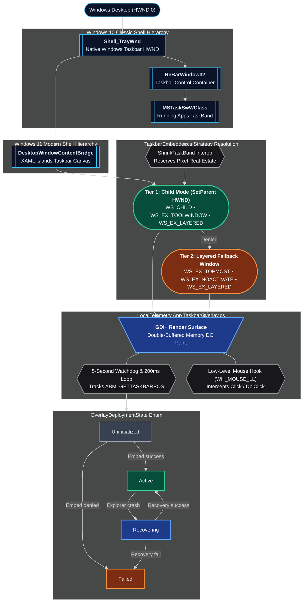

# :app-window: Win32 Taskbar Hooking & Overlay Interop

LocalTelemetry embeds a high-performance GDI+ render surface (`NativeWindow`) directly into the native Windows taskbar process (`Shell_TrayWnd`).

## :layers: Win32 Taskbar Hierarchy & State Machine

The taskbar overlay management is handled inside `TaskbarOverlay.cs` and `TaskbarEmbedder.cs`.



## :settings: Taskbar Embedding Strategies

Implemented in [`TaskbarEmbedder.cs`](https://github.com/Nicconike/LocalTelemetry/blob/master/src/LocalTelemetry.App/Win32/TaskbarEmbedder.cs), LocalTelemetry provides a 2-tier embedding engine to guarantee compatibility across all Windows 10 and 11 builds:

### :shield-alert: Child-Window Reparenting (`IsChildMode`)

- **Find Taskbar HWND**: `FindWindow("Shell_TrayWnd", null)` locates the primary taskbar window handle.
- **Find ReBar / TaskBand**: `FindWindowEx(trayHwnd, IntPtr.Zero, "ReBarWindow32", null)` retrieves the control container and taskband (`MSTaskSwWClass`).
- **Reparent Window (`SetParent`)**: Calls Win32 `SetParent(overlayHwnd, parentHwnd)` to reparent the overlay window as a native child control of the taskbar.
- **Shrink TaskBand (`ShrinkTaskBand`)**: Dynamically reduces taskband width to reserve dedicated space for the overlay metrics on the taskbar.
- **Apply Window Styles (`SetWindowLong`)**: Sets `WS_CHILD`, `WS_EX_TOOLWINDOW` (hides from Alt+Tab), `WS_EX_NOACTIVATE`, and `WS_EX_LAYERED`.

### :panel-bottom: Layered Floating Window Fallback (`IsFallback`)

- Activated if reparenting fails due to third-party shell software or security policies.
- Restores top-level window styles (`WS_POPUP`, `WS_EX_TOPMOST`) and positions a transparent layered floating window precisely over the taskbar bounding rectangle.

---

## :cloud-backup: Deployment Lifecycle State Machine

`TaskbarEmbedder.cs` tracks overlay attachment health using `OverlayDeploymentState`:

```csharp
public OverlayDeploymentState State { get; private set; } = OverlayDeploymentState.Uninitialized;
```

1. **`Uninitialized`**: Overlay is hidden or has not yet completed initial taskbar discovery.
2. **`Active`**: Taskbar handle verified and overlay successfully positioned (either as child or layered fallback).
3. **`Failed`**: Taskbar handle not found or `SetParent` call failed.
4. **`Recovering`**: Watchdog detected that `explorer.exe` restarted; attempting re-embedding cycle.

---

## :palette: GDI+ Double-Buffered Rendering Engine

Implemented in [`TaskbarOverlay.cs`](https://github.com/Nicconike/LocalTelemetry/blob/master/src/LocalTelemetry.App/Overlay/TaskbarOverlay.cs), `TaskbarOverlay` inherits from `System.Windows.Forms.NativeWindow`:

- Renders hardware metrics into an in-memory double-buffered bitmap using GDI+ (`System.Drawing.Graphics`).
- Caches font families and solid brushes to eliminate memory allocations on high-frequency polling ticks.
- Updates the layered window surface using `UpdateLayeredWindow` / `SetLayeredWindowAttributes`.
- When an alert triggers, applies a visual warning tint across the buffer (`rgba(255, 80, 0, 0.24)`).

---

## :monitor: High-DPI Awareness & Scaling

Queries `GetDpiForWindow` to dynamically scale font rendering, text margins, and line heights for 4K displays and custom DPI scaling settings (100%, 125%, 150%, 175%, 200%+).

---

## :refresh-cw: Windows Explorer Restart Recovery

When `explorer.exe` crashes or restarts, all child window handles of `Shell_TrayWnd` are destroyed by the operating system:

1. **5-Second Heartbeat Watchdog (`_watchTimer`)**:
   A background timer polls `TaskbarEmbedder.FindExplorerTrayWnd()` every 5 seconds. If the taskbar window handle changes or is recreated, it immediately triggers `OnTaskbarRecreated()` on the UI thread:

```csharp
private void WatchdogTick()
{
    IntPtr currentTray = NativeMethods.FindWindow("Shell_TrayWnd", null);
    if (currentTray != _lastKnownTray && currentTray != IntPtr.Zero)
    {
        Log.Info("Explorer restart detected; re-embedding taskbar overlay");
        _dispatcher.Invoke(ReembedOverlay);
    }
}
```

1. **State Transition to `Recovering`**:
   During re-embedding, `State` transitions to `OverlayDeploymentState.Recovering`. Once positioning succeeds, it returns to `Active`.
